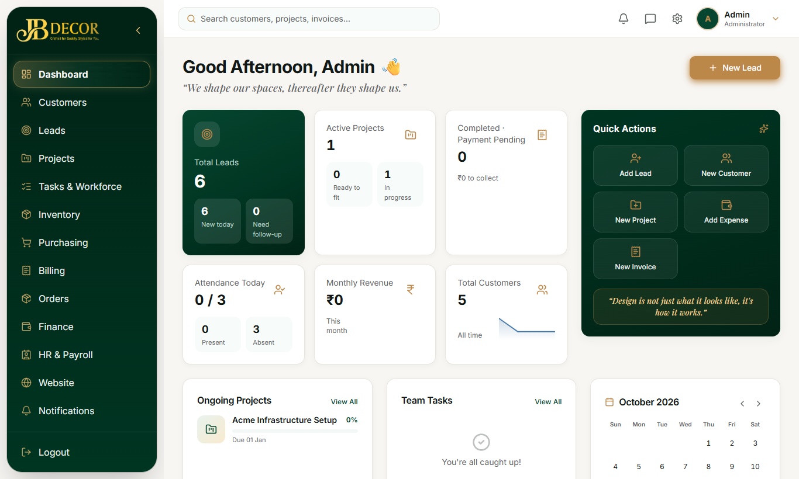
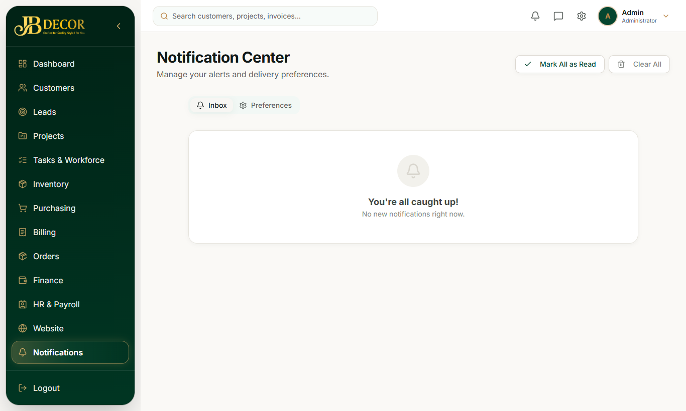

# Admin Guide — Dashboard, Navigation & Notifications

**URLs:** `/dashboard`, `/notifications` · **Related:** 15-users-and-settings

## 1. Layout
- **Left sidebar** (deep-green, collapsible): Dashboard, Customers, Leads, Projects, **Tasks & Workforce**, Inventory, Purchasing, Billing, Orders, Finance, **HR & Payroll**, Website, Notifications, then Users and Settings, and Logout at the bottom. An item shows only if your account has that module's permission; admins see all.
- **Top bar:** search box, notification bell with count, Settings shortcut, profile menu showing your account type, and logout.
- **Phones/tablets:** a bottom bar shows Home, Customers, Leads, Projects and a menu for the rest.
- Every page **Back** button returns to where you came from.
- Language (English, Hindi, Tamil, Telugu) is chosen in Settings → Preferences.

<!-- screenshots -->

*Figure: The Dashboard: KPI cards, Quick Actions and the left menu*

*Figure: Notification center*
<!-- /screenshots -->

## 2. Dashboard
A greeting and a gold **New Lead** button, then KPI cards, each clickable to its module:
- **Total Leads** (New today, Need follow-up)
- **Active Projects** (Ready to fit, In progress)
- **Completed · Payment Pending** (amount still to collect)
- **Attendance Today** (present / total, Present and Absent counts)
- **Monthly Revenue**
- **Total Customers**

**Quick Actions** panel: Add Lead, New Customer, New Project, Add Expense, New Invoice.
Below: **Ongoing Projects**, **Team Tasks** and a month calendar.

## 3. Notifications (`/notifications`)
- Each user sees only their own notifications.
- Management events go to admins: new lead, task completed, material request, manpower request, daily report, payment pending approval, project conversion request, missed check-outs.
- Employees get notifications for tasks assigned, approvals, leave and payslip decisions.
- Click a notification to open the related page. You do not get notified about your own actions.

## 4. Common questions
**Q: A menu item is missing.** Your account lacks that module's permission; ask an admin (guide 15).
**Q: Logged in but I land on the employee screen.** Employee accounts open the mobile portal; only Admin accounts get the desktop app.
**Q: How do I change language?** Settings → Preferences.
