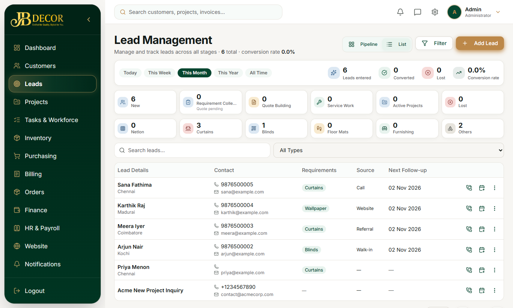
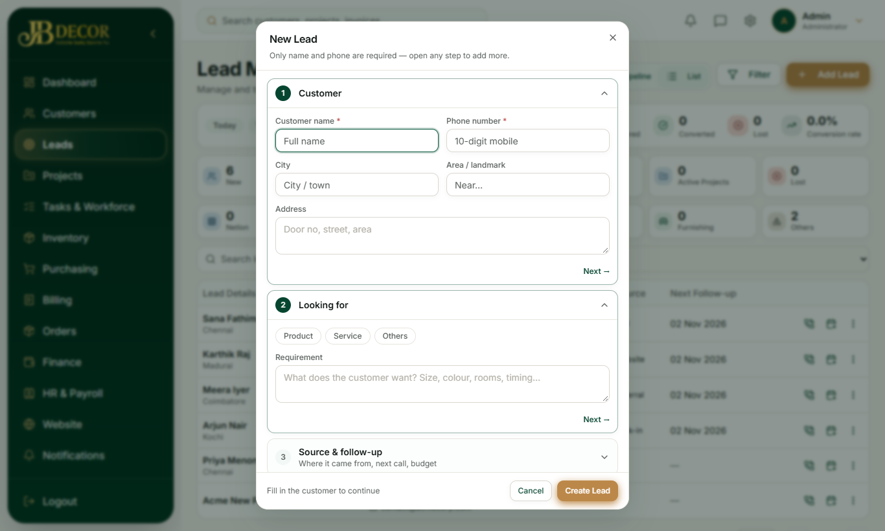
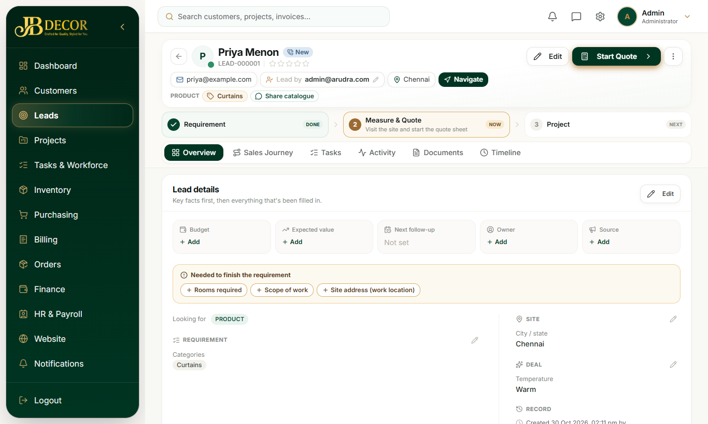
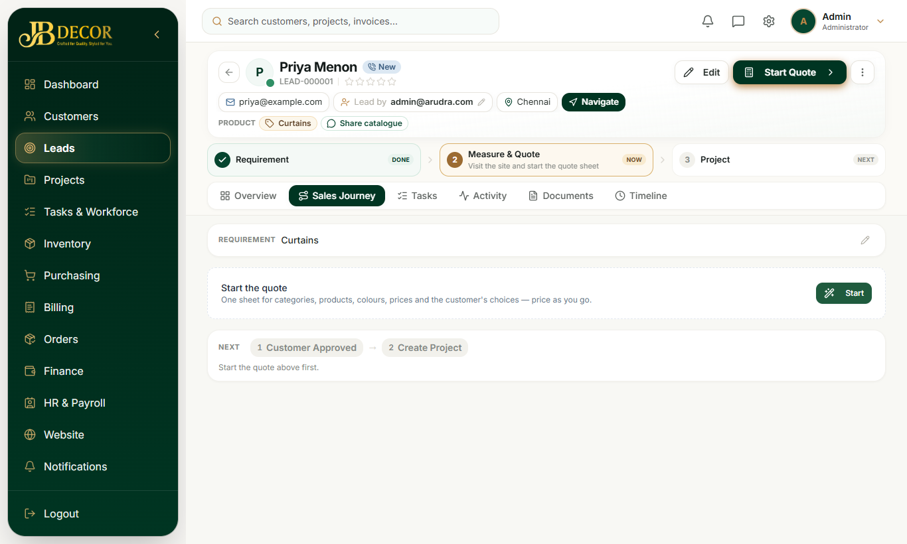

# Admin Guide — Leads

**Audience:** Admin (and employees with lead permission) · **Menu:** Leads · **URLs:** `/leads`, `/leads/:id`
**Related guides:** 04-site-visit-measurement-quote, 05-projects, 06-tasks, employee/03-lead-work

## 1. What this module is for
A *lead* is a possible customer enquiry (from the website, a call, a walk-in, a referral or an employee). The Leads module tracks the enquiry from first contact to a quote and then to a project. Every lead has a short **journey**: **Requirement → Measure & Quote → Project**.

<!-- screenshots -->

*Figure: Lead list*

*Figure: Add Lead dialog*

*Figure: Lead profile: header, journey bar and tabs*

*Figure: Sales Journey tab*
<!-- /screenshots -->

## 2. Screens

### 2.1 Lead list (`/leads`)
- Title **Lead Management**. Toggle **Pipeline** (board) or **List**; **Filter** button; **Add Lead**.
- Period chips: Today, This Week, This Month, This Year, All Time.
- Count tiles: New, Requirement Collected (quote pending), Quote Building, Service Work, Active Projects, Lost, then category tiles (Netlon, Curtains, Blinds, Floor Mats, Furnishing, Others). Click a tile to filter.
- Filters: **Enquiry type** (Product / Service / Others), **Category**, **Product**, **Service**, source, assignee.
- Columns: Lead Details, Contact, Requirements, Source, Next Follow-up, and call/schedule/⋮ actions.

### 2.2 Create / Edit Lead dialog (7 collapsible steps)
Steps 1–2 are open by default; the rest collapse and show a tick plus a one-line summary.
1. **Customer** – pick an existing customer or type a new name and phone (name and phone are required).
2. **Looking for** – Enquiry tag: **Product**, **Service** or **Others**. Pick one or more categories (chips), and optionally products. For Service, pick the service and the product it is for.
3. **Source & follow-up** – source chips (Website, Referral, Walk-in, …) and next follow-up date and time. If source is **Referral**, a *Referral Details* block appears: referred by *Existing Customer*, *Employee* or *Other*, plus notes.
4. **Contact & address** – phone, WhatsApp, email, address, city, map pin.
5. **Photos & voice** – attach photos and voice notes.
6. **Property & scope** – property type, floors, area, scope notes, budget.
7. **Priority, timeline, team** – priority, temperature, expected closing, team members (Sales Executive, Project Manager, Engineer).

### 2.3 Lead profile (`/leads/:id`)
- **Header band:** name, lead number, status chip, star rating, contact chips (email, lead-by, city, **Navigate**), enquiry/category/product chips, **Share catalogue**, and the journey bar (Requirement DONE → Measure & Quote NOW → Project NEXT). **Edit** button beside the primary button.
- **One primary button** (for example **Start Quote**) that changes with progress: *Add requirement* → *Start / Continue Quote* → *Create Project* → *View Project* → *Reopen Lead*.
- A ⋯ menu holds *Convert to customer only*, assign, mark as lost, delete.
- **Tabs (in order):**
  - **Overview** – one "Lead details" card. Read mode shows only filled fields. Click **Edit**, change anything, then **Save** (it saves details, team and referral together).
  - **Sales Journey** – requirement brief, then the Quote Workspace (see guide 04), then project cards.
  - **Tasks** – follow-up reminders and tasks for this lead.
  - **Activity** – call and note history.
  - **Documents** – files, photos, voice notes and linked call recordings.
  - **Timeline** – every status change and action in order.

## 3. Step-by-step tasks

### Create a lead
1. Open **Leads** → **Add Lead**.
2. Fill step 1 (name, phone). Open step 2 and choose the enquiry tag and categories.
3. Fill any other steps you know. Press **Save** in the sticky footer.
4. The lead gets a *Collect Requirement* task automatically (see guide 06).

### Follow up a lead
1. Open the lead → **Tasks** or **Activity**.
2. Add a follow-up with method (Call / WhatsApp / Email / Meeting), outcome and next date/time.
3. The lead's *next follow-up* updates and the lead appears in the follow-up reminders.

### Assign people
1. Lead profile → Overview → Edit → *Team*, or the ⋯ menu → Assign.
2. Choose Sales Executive, Project Manager and Engineer.

### Mark a lead lost
⋯ menu → **Mark as lost**, give a reason, competitor (optional) and customer feedback. The lead status becomes *Lost*. Use **Reopen Lead** to bring it back.

### Convert to customer only
⋯ menu → **Convert to customer only**. This only creates a Customer record. To create a **project**, go to Sales Journey → Quote and use *Create Project*.

## 4. Rules & status flow
- The list/board stages follow the journey: New → Requirement Collected → Quote Building → Active Project, plus Service Work and Lost. (Older leads may still carry the earlier statuses New, Contacted, Qualified, Proposal Sent, Negotiation, Site Visit Scheduled, Quotation Approved, Closed.)
- A lead cannot be converted to a customer twice.
- The default workflow creates **only the first task** (Collect Requirement) at lead creation. Later tasks (Site Visit & Measurement, BOQ & Quotation) appear as each one finishes.
- Referral details are edited separately from other lead details, so editing a lead never wipes the referral and vice versa.
- Enquiry **Category** may be several categories, stored as a comma-separated list.

## 5. Automatic things
- New lead → a Collect Requirement task is created and notifications go to admins.
- Website enquiries and employee-created leads arrive in the same list, tagged with their source.
- Call recordings uploaded by admin can become leads (see 06-tasks, Call Recordings).
- Data-entry leads are held for a short window (default 10 minutes) and are released automatically if nobody starts them.

## 6. Common questions
**Q: Why can't I see the stat tiles (next follow-up, expected value) in the header?** They were removed from the header; edit them in Overview → Deal section.
**Q: "Convert to Project" didn't create a project.** The ⋯ item is customer-only. Create the project from Sales Journey → Quote → *Create Project*.
**Q: An employee created a lead; where do I see it?** In the Leads list, same as any lead; the source shows the employee portal.
**Q: How do I record who referred a customer?** Set Source = Referral when creating, or edit the Referral card in Overview.
**Q: Can I delete a lead?** Yes from the ⋯ menu; it is a permanent delete, so prefer *Mark as lost*.
