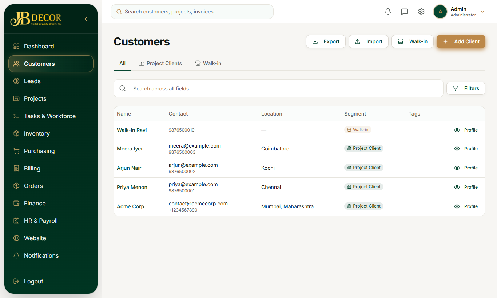
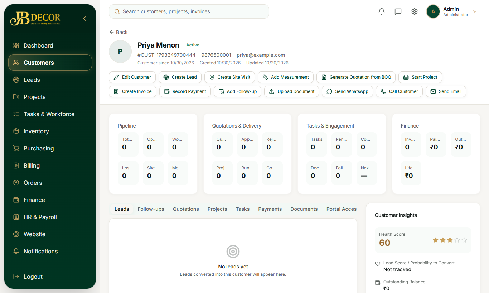

# Admin Guide — Customers

**Menu:** Customers (`CUSTOMER_READ`) · **URLs:** `/customers`, `/customers/:id`
**Related:** 02-leads, 10-billing, 05-projects

## 1. Purpose
The master list of people and companies you sell to, with their full history in one place.

<!-- screenshots -->

*Figure: Customer list*

*Figure: Customer profile*
<!-- /screenshots -->

## 2. Screens
### Customer list
- Segment tabs: **All**, **Project Clients**, **Walk-in**.
- Columns: Name, Email, Phone, City, Tag, with a Profile link. **Filters** button for more.
- Buttons: **Export**, **Import**, **Walk-in** (quick add for a counter customer, name and phone only) and **Add Client** (full details for a project client).
- Export gives Excel, CSV or PDF.

### Customer profile
Header buttons: **Back**, **Edit Customer**, **Add Follow-up**, **Upload Document**. A quick-actions strip: **Create Lead**, **Create Site Visit**, **Add Measurement**, **Generate Quotation from BOQ**, **Start Project**, **Create Invoice**, **Record Payment**, **Send WhatsApp**.
Tabs: **Leads**, **Follow-ups**, **Quotations**, **Projects**, **Tasks**, **Payments**, **Documents**, **Portal Access**, **Activity Log**. Financial figures need the `CUSTOMER_FINANCIAL_READ` permission.

## 3. Step-by-step tasks
### Add a customer
Customers → **Walk-in** (quick) or **Add Client** (full) → fill and Save.
### Customer from a lead
On the lead ⋮ menu choose *Convert to customer only*. Customers are also created automatically when a project is created and when a counter sale quick-adds a walk-in (found by phone/email first to avoid duplicates).
### Export
Press **Export** on the list and choose Excel, CSV or PDF. **Import** loads customers from a file.
### Portal access
Portal Access tab: the self-service customer portal is currently off on the public site; access is granted only by admin and not by self sign-up.

## 4. Rules
- Segment is **Walk-in** for counter-sale-only customers and **Project Client** for everyone else. A customer who later becomes a project client is not demoted.
- Deleting needs `CUSTOMER_DELETE`; writing needs `CUSTOMER_WRITE`.

## 5. Common questions
**Q: Walk-in customer appears twice.** Counter sale matches by phone then email; fix by editing the phone number and removing the duplicate.
**Q: Where are a customer's payments?** Profile → Payments.
