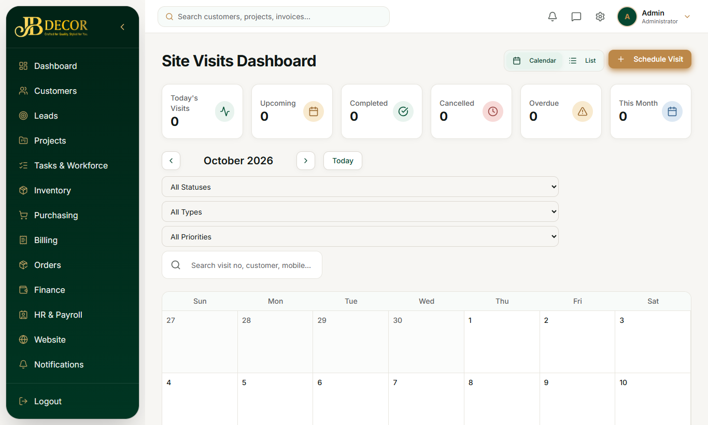
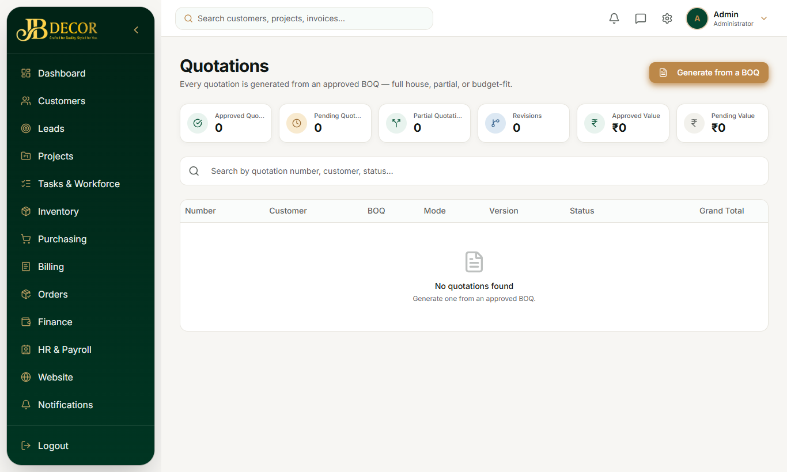

# Admin Guide — Site Visit, Measurement, BOQ & Quotation (Quote Workspace)

**Menu:** inside **Leads** (Sales Journey tab) · **URLs:** `/site-visits*`, `/measurements*`, `/boq*`, `/quotations*`
**Related guides:** 02-leads, 05-projects, employee/03-lead-work

## 1. Purpose
Turn a requirement into a priced quote the customer can approve. Measurement, BOQ (bill of quantities) and Quotation are treated as **one workspace** on the lead page, "made only for the quotation".

<!-- screenshots -->

*Figure: Site visits*

*Figure: Quotations list*
<!-- /screenshots -->

## 2. Screens

### 2.1 Quote Workspace (Lead → Sales Journey tab → "Measure & Quote")
Three always-open parts:
1. **Site & room sizes** – press **Start pricing** (creates the measurement and a BOQ sheet from the lead). Toggle **Room sizes & scope** to enter rooms and measurements; changes sync into the price sheet automatically after a short pause (no Sync button).
2. **Price (BOQ sheet)** – a spreadsheet-style editor:
   - Lines are grouped by **Category** (or "Others"). Each category card has a header with tick-all, subtotal and a ⋮ menu (rename / remove).
   - Each line: tick, photo, name (a "Custom" badge if not from the catalogue), colour, location, description, qty, unit, rate, discount (% or ₹), amount.
   - Add a category with the **Add category** bar (type a name or choose a saved one). Add a product with the product picker (search catalogue with thumbnails). Colour cell lists the product's colours; choosing a colour with a photo swaps the line image; "Other colour…" is free text.
   - Open a line's chevron for size, category move and cost breakdown (materials and labour).
   - Edits save when you leave the cell or press Enter (Enter moves to the same column on the next row).
   - Bulk actions: add labour to selected lines, copy lines from another item.
3. **Quote** – set customer discount, GST, **labour charge** and **shipping charge** (both taxed), then **Generate** the quotation.

### 2.2 Other screens
- **Site visits** (`/site-visits`, `/new`, `/:id`): schedule, assign an engineer, record observations, photos, rooms and measurements, take the customer's signature (this marks the visit Completed), reschedule.
- **Measurements** (`/measurements`, `/new`, `/:id`, `/catalog`): formal measurement records. The **catalog** is the admin-managed list of standard measurement items employees pick from.
- **BOQ** (`/boq*`): legacy list/entry/details/reports pages kept for older leads; new work uses the workspace.
- **Quotations** (`/quotations`, `/new`, `/:id`, `/:id/print`): list, detail with items/discounts/taxes/terms, and a printable PDF layout.

## 3. Step-by-step tasks

### Make a quote for a lead
1. Open the lead → **Sales Journey**.
2. Press **Start pricing**.
3. Enter rooms and sizes (optional but recommended).
4. In **Price**, add categories and products, set qty, rate and discounts.
5. In **Quote**, add labour and shipping, set discount and GST.
6. Press **Generate** to create the quotation. It is a *Draft* until approved.
7. Share/print from `/quotations/:id` or the lead; the customer can open the no-login link `/q/:token`.

### Revise an approved price sheet
An approved sheet shows a **locked** banner. Use **new revision** to create an editable copy; the old quote becomes *Revised*.

### Customer agrees → create the project
- **Admin / Project Manager:** in the Quote step press **Create Project** (the quote must be customer-approved).
- **Field employee:** presses **Send for Approval** (optionally with advance amount, method, reference and receipt photo). Status shows "Waiting for admin approval". The admin sees a banner in the workspace and presses **Approve** (advance editable) or **Reject** (reason; the sheet reopens as a new revision and the employee is notified).

### Change a quote on a running project
Project → Commercial → **Quotation** → start a **change**. The same project and sheet are edited in place. On approval the project budget, work items, supply rows and unbilled payment milestones update; the project is never duplicated. Lines already started on site cannot be removed, only re-quantified. Only Admin or Project Manager can start, approve or discard a change.

## 4. Rules
- Totals order: lines (after line discounts) − customer discount + labour + shipping = taxable → + GST = grand total.
- Customer discount applies to products only.
- A project cannot be created from a quote that is not customer-approved.
- Over-payment after a lower total is only *shown* ("excess paid"), never auto-credited.
- Rates are `amount ÷ qty` rounded to 2 decimals, so odd quantities can show paise differences.
- Quote statuses: DRAFT → APPROVED → CONVERTED (to project); an older version becomes REVISED.

## 5. Automatic things
- Pricing sheet and measurement stay in sync both ways.
- At conversion: lead documents, measurement drawings and media are copied into the project; material needs are loaded and linked to catalogue products by name matching; a "Project Execution" and an "Installation" task are created.

## 6. Common questions
**Q: The sheet is read-only.** It is approved or owned by a project. Create a revision (lead) or start a change (project).
**Q: My product has no catalogue match.** Add it as a custom line; it still prices correctly but will not auto-link to stock.
**Q: Employee can't create the project.** By design they send it for approval; admin approves.
**Q: Where does the customer approve?** On the public quote link `/q/:token`, or you mark *Customer approved* in the workspace.
