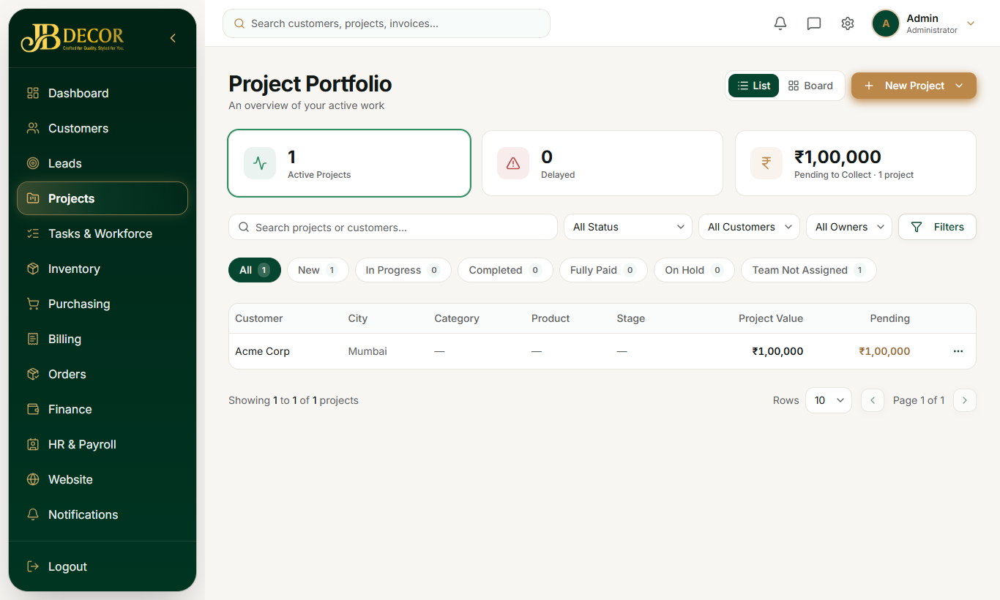
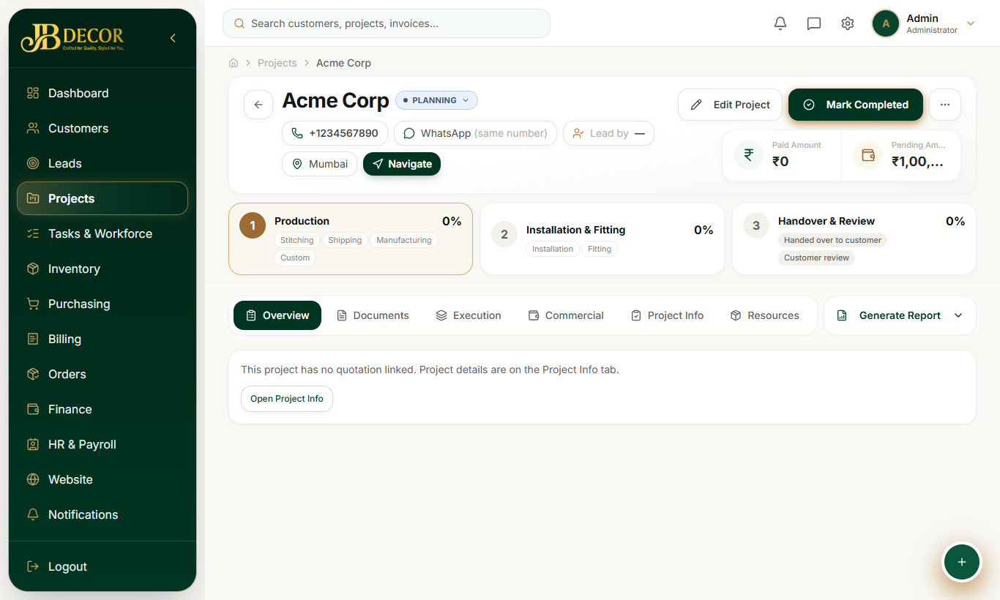

# Admin Guide — Projects (Project Command Center)

**Menu:** Projects · **URLs:** `/projects`, `/projects/:id`, `/projects/:id/tasks/:taskId`, `/projects/:id/files`
**Related:** 04-site-visit-measurement-quote, 06-tasks, 09-purchasing, 10-billing, 11-finance, 13-contractors

## 1. Purpose
One page per customer project that holds everything: team, work progress, materials, purchases, payments, documents, handover and after-sales service.

<!-- screenshots -->

*Figure: Project list*

*Figure: Project page overview*
<!-- /screenshots -->

## 2. Screens

### Project list (`/projects`)
Title **Project Portfolio**. **List / Board** toggle, **New Project**, **Filters**, and status chips: All, New, In Progress, Completed, Fully Paid, On Hold, Team Not Assigned, plus a Delayed counter.

### Project page (`/projects/:id`)
**Header:** customer name, contact (call, **WhatsApp (same number)**, **Navigate**), Paid Amount and Pending Amount, a status pill (for example PLANNING), and a 3-stage journey bar — *Production → Installation & Fitting → Handover & Review*. Buttons: **Edit Project**, **Mark Completed** (also in the ⋯ menu with *Cancel Project*), **Generate Report**.

**Tab strip (7 tabs, plus one that appears later):**
- **Overview** – an "attention bar" (overdue tasks, critical open issues, delayed tasks, pending approvals, unpaid invoices, no project manager, materials not issued; green "On track" when clear), 4 tiles (Work progress, Tasks, Collected vs contract, Budget used), Project details (inline edit), recent activity, 6 quick actions, **Project Team** panel (assign Project Manager, Assistant Manager and team members) and "Today on site".
- **Documents** – every project file gathered live (photos, drawings, call recordings, lead documents).
- **Execution** – one screen, **Execution & Installation**: per-product steps, installation checklists, daily log, team chat and history.
- **Commercial** – a drop-down of sections: **Billing & Payments** (toggle Invoices | Payments, **Record Payment**, Approve/Reject for pending money, profit and expenses), **Quotation** (the project's sheet and quote; start a **change** here), **Approvals & Changes** (change requests).
- **Project Info** – full project details (client, address, scope, dates).
- **Resources** – **Purchase Orders** and **Goods Received** (project-tagged).
- **Activity** – log of everything that happened.
- **Service & Warranty** – appears only when the project is Completed.

**Handover** is no longer a tab: press **Mark Completed** and a handover sheet opens (handover photos, two ticks — *client approved* and *every product delivered* — and optional notes).

## 3. Step-by-step tasks

### Assign the team
Overview → **Project Team** panel → choose Project Manager and Assistant Manager (and team members) → Save. They receive notifications.

### Track execution
1. Employees work on the shared **Project Execution** and **Installation** tasks from the mobile portal (see employee/02-tasks).
2. Each product line has steps (Material, Manufacture, Stitching, Delivery). Material % follows linked purchase orders automatically; delivery can be *Direct* or *Pickup*.
3. Project % = average of Execution and Installation, capped at 99% until the closing task is approved.

### Collect a payment
Commercial → Billing & Payments → Payments → **Record Payment** (amount, method, reference). Employee-collected cash arrives as *Pending approval*; press **Approve** or **Reject**.

### Hand over to the customer
Press **Mark Completed** (header or ⋯ menu). In the handover sheet add handover photos, tick **client approved** and **products delivered**, add notes if needed, and confirm. The project becomes Completed with a handover date, and the photos go to Documents. If a readiness check blocks it you can override it explicitly.

### Cancel a project
Status pill → **Cancel Project** → give a reason and optional refund of advance paid (up to paid minus already-refunded). Open tasks are cancelled; unpaid invoices are cancelled; part-paid invoices stay. Refund follows Pending → Approved → Paid and posts to the ledger. Not allowed on Completed/Closed/Cancelled projects.

### After-sales (warranty)
Completed project → **Service & Warranty** → activate cover (default 6 months service, 12 months product, from Website settings) → log service works as Free or Paid. A paid work can raise a service invoice. Each service work also creates a task.

## 4. Rules
- Project status flow: Planning → Active → Completed, or Cancelled.
- Closing task = Installation. It needs admin approval plus the required payment before the project can complete.
- Employees cannot create projects directly; they request, admin approves (see guide 04).
- Profit is shown two ways: cash basis (customer paid − contractor/product costs paid) and accrual.
- Project purchase orders only accept receipts while the PO is open (Approved/Sent/Confirmed/Partial), and one shipping ID cannot be received twice.

## 5. Automatic things
- Project creation copies lead documents, drawings, media; seeds the two shared tasks; loads material needs from the quote.
- Progress-linked billing: when work reaches a milestone %, the matching payment-schedule invoice is raised as *Due* and admins are notified.
- Notifications go to the project manager and admins on delays, approvals and payments.

## 6. Common questions
**Q: Project % stuck at 99.** The closing Installation task is not approved yet.
**Q: Cannot remove a quote line in a change.** It already has progress on site; re-quantify instead.
**Q: Where do I see all files?** Documents tab (or `/projects/:id/files`).
**Q: Mark Completed is blocked.** The readiness check found something open; fix it or confirm the override.
**Q: Customer paid more than the new total.** Shown as "excess paid"; refund through Cancel/Refund flow if needed.
