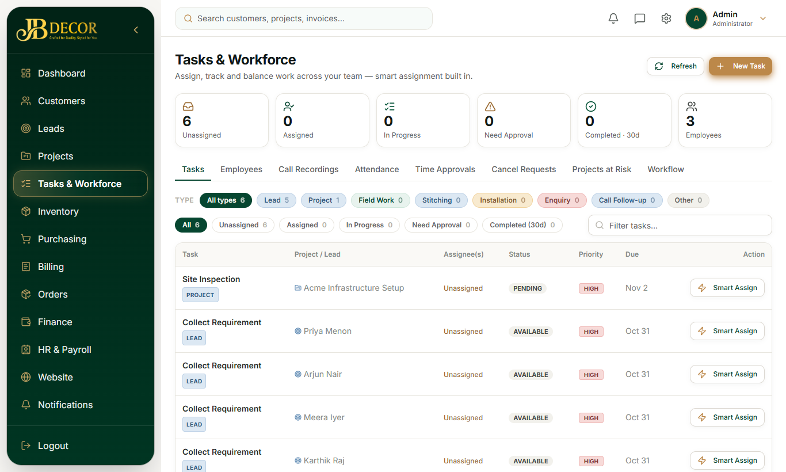

# Admin Guide — Tasks, Smart Assignment & Call Recordings

**Menu:** Tasks (`TASK_READ`) · **URL:** `/tasks` (old `/workflow` and `/assignments` redirect here)
**Related:** 02-leads, 05-projects, employee/02-tasks

## 1. Purpose
One hub to see every task (lead tasks, project tasks, field tasks, call follow-ups, service works), assign them, approve completed work, and manage call recordings.

<!-- screenshots -->

*Figure: Tasks hub*
<!-- /screenshots -->

## 2. Tabs
- Title **Tasks & Workforce**; buttons **Refresh** and **New Task**. Top counters: Unassigned, Assigned, In Progress, Need Approval, Completed · 30d, Employees.
- **Tasks** – filter chips: All, Unassigned, Assigned, In Progress, Need Approval, Completed. Tasks are grouped into *type lanes* (All types, Lead, Project, Field Work, Stitching, Installation, Enquiry, Call Follow-up, Other). Each row has **Smart Assign**, which shows the top 5 recommended employees (name, code, score) with one-click Assign. Create/edit a task with checklist; Approve or Reject completed work.
- **Employees** – roster: tasks assigned now, completed in last 24 hours, working-now dot. Admin-only **Assign task** to any employee (ignores daily capacity).
- **Call Recordings** – upload call audio; the system reads phone number, time and direction from the file name, creates a follow-up task, and an employee records an outcome that closes it (or creates a lead).
- **Attendance**, **Time Approvals**, **Cancel Requests**, **Projects at Risk**, **Workflow** (templates) – admin only.

## 3. Step-by-step tasks

### Assign a task
1. Tasks tab → find the task → **Smart Assign**.
2. Pick a recommended employee (score = eligibility + workload + skills) → Assign. Or use Employees tab → Assign task.

### Approve work
Filter **Need Approval** → open the task → Approve or Reject (with remark).

### Turn a call recording into a lead
1. Call Recordings → upload files (one per request).
2. The system makes a *Call Follow-up* task for the employee.
3. Employee outcome closes it: create lead, attach to existing lead, or Not a lead. A recording attached to a lead appears in the lead's Documents and project Documents.

### Edit the lead workflow templates
Workflow tab (admin only) shows the task templates per phase.

## 4. Rules
- Default lead workflow: **Collect Requirement → Site Visit & Measurement → BOQ & Quotation**, one at a time; only the first task exists at lead creation.
- Collect Requirement is open to anyone; completing it needs the requirement form and ≥10% gate in the employee To-Do.
- Every project gets two shared tasks: **Project Execution** and **Installation**. Installation is the closing task and needs admin approval.
- Call Follow-up tasks cannot be completed plainly; only an outcome closes them.
- Capacity (max tasks per day) affects recommendations, not manual assignment.
- Employees see tasks of leads that are converted or past the quote stage hidden from their To-Do.

## 5. Automatic things
- Task seeding of a trade-aware "Work Steps" checklist on create.
- A lead data-entry hold: un-started data-entry leads auto-release after the hold window (default 10 min; 0 disables).
- Notifications on assignment, completion and approval.

## 6. Common questions
**Q: Where did Smart Assign and Workflow Console go?** Merged into `/tasks`.
**Q: Employee can't complete the call task.** Choose an outcome instead of Complete.
**Q: Why does the same task show for several people?** Team tasks (Project Execution) allow anyone eligible to *Join*.
