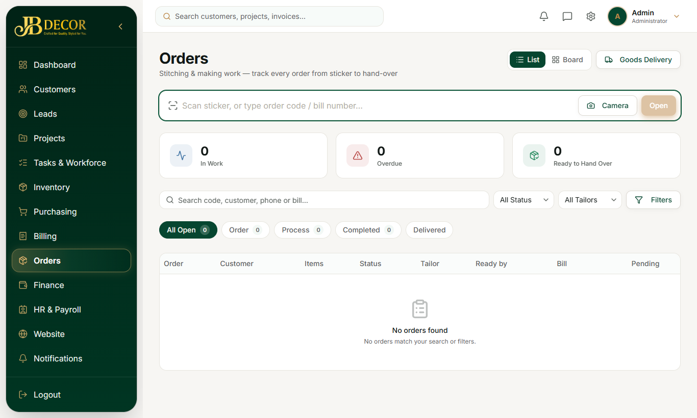

# Admin Guide — Orders (Bundles) & Goods Delivery

**Menu:** Orders (`BUNDLE_READ`) · **URLs:** `/bundles`, `/bundles/:id`, `/bundles/code/:code`, `/bundles/delivery` (`/orders` redirects)
**Related:** 10-billing (counter sale), employee/05-requests-and-field

## 1. Purpose
After a counter sale, a customer's own material that needs stitching or making is tracked as a physical **order bundle** with a sticker code (e.g. `JB-0042`, or `JB-0042-1` / `-2` for multi-bundle orders). Tracking is internal only; customers are not given a tracker for bundles.

<!-- screenshots -->

*Figure: Orders list*
<!-- /screenshots -->

## 2. Screens
- **Orders list** – counters (In Work, Overdue, Ready to Hand Over), a code box with **Open** and **Camera** scan, **List / Board** toggle, **Goods Delivery** button, **Filters**, and status chips All Open, Order, Process, Completed, Delivered.
- **Order detail** – items, work specification, status, history. QR on the sticker opens this page.
- **Goods Delivery** (`/bundles/delivery`) – deliver Completed or Process orders and collect the pending balance.

## 3. Status flow
**ORDER → PROCESS → COMPLETED → DELIVERED**
- *INSTALL* step appears only if the bill includes installation; the installer presses **Mark Installed**.
- There is no hold step in the current version.
- Cancelling the bill cancels its bundles.

## 4. Step-by-step tasks

### Create bundles (counter sale)
1. Billing → Counter Sale (see guide 10).
2. Tick **needs work** on lines, add work spec and a "Stitching Charges" line (5% GST).
3. Save; the invoice page opens the **sticker** print dialog (sizes 50×25, 4×6, A4, plus job card).

### Move an order forward
Open the bundle (scan the sticker) → press the next status. Non-managers can only take the next step. Admin/Manager can skip ahead or step back; this is logged as an override.

### Deliver
Goods Delivery → pick the order → collect the full pending amount → confirm. Orders in *Process* need a remark before delivery.

## 5. Common questions
**Q: Where do I print stickers again?** Invoice detail page → bundles card → print stickers.
**Q: Customer wants to track the order.** Bundles are internal; project/order tracking links (`/track/:token`) apply to projects and website orders.
**Q: Who can move the status?** `BUNDLE_MOVE` holders step forward; `BUNDLE_WRITE`/Admin can override.
