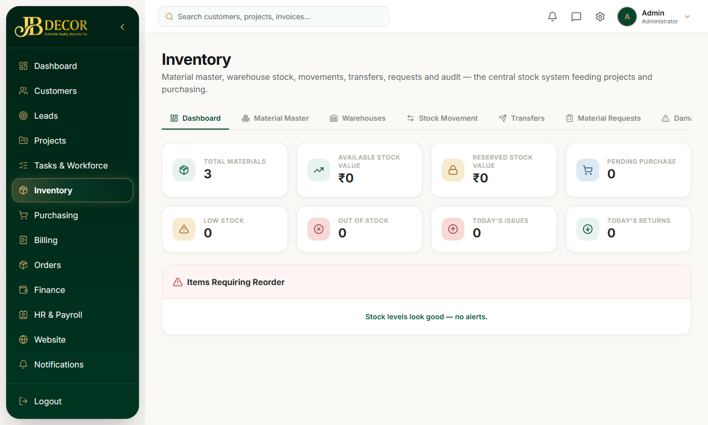
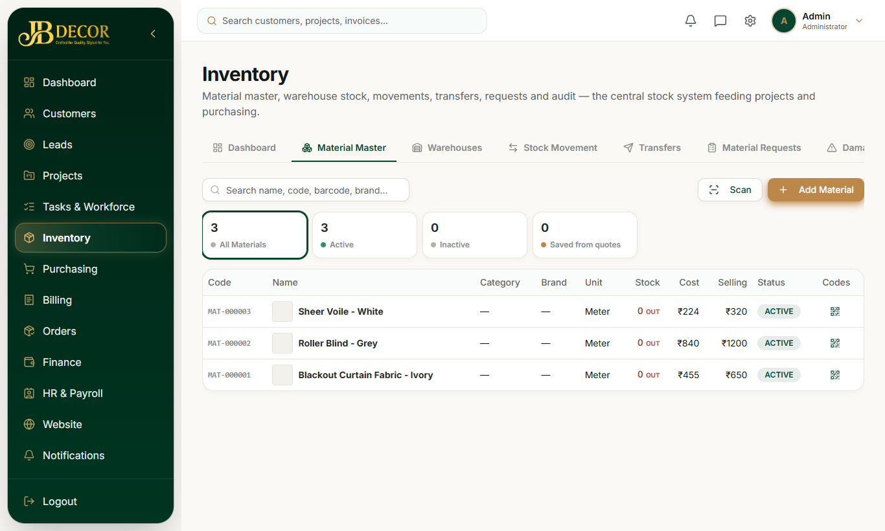

# Admin Guide — Inventory

**Menu:** Inventory (`INVENTORY_READ`) · **URLs:** `/inventory`, `/inventory/materials`, `/warehouses`, `/stock-movement`, `/transfers`, `/material-requests`, `/damage`
**Related:** 09-purchasing, 10-billing (counter sale deducts stock), 05-projects (project materials)

## 1. Purpose
Keep the product/material catalogue and stock levels per warehouse, and record every stock movement.

<!-- screenshots -->

*Figure: Inventory dashboard*

*Figure: Material master*
<!-- /screenshots -->

## 2. Tabs
- **Dashboard** – tiles: Total Materials, Available Stock Value, Reserved Stock Value, Pending Purchase, Low Stock, Out of Stock, Today's Issues, Today's Returns.
- **Material Master** – the product catalogue. **Add Material** opens a short form with the essentials and collapsible extras (media gallery, fabric specs such as composition, width, GSM, pattern, colour; window/design details such as product type, mounting, opacity, suitable rooms). Products can have several **colours**, each with a photo.
- **Warehouses** – create and manage stock locations.
- **Stock Movement** – every in/out/adjustment. Types: PURCHASE, OPENING, ADJUSTMENT, PROJECT_RETURN (in); CONSUMPTION, sale (out); PURCHASE_RETURN.
- **Transfers** – move stock between warehouses with request → approve → complete.
- **Material Requests** – requests raised by employees or projects, approved and fulfilled from stock.
- **Damage Entries** – record damaged items so they leave sellable stock.

## 3. Step-by-step tasks

### Add a product
1. Inventory → Material Master → **Add Material**.
2. Enter name, category, unit, prices, opening stock if any.
3. Open the extras to add photos, colours and specs. Save.

### Adjust stock
Stock Movement → new entry → choose type, product, warehouse, quantity, reason.

### Transfer between warehouses
Transfers → New → from/to warehouse and items → approve (needs approval permission) → complete.

### Approve a material request
Material Requests → open the request → Approve (or reject with reason) → issue stock.

## 4. Rules
- Units come from one app-wide list (length, area, volume, count, weight, liquid, labour). Old spellings like "Square Feet" are recognised.
- Goods received that fail quality control or are damaged never enter stock.
- Project materials are tagged to the project; stock out to a project is a CONSUMPTION movement.
- Selling a product at the counter deducts stock if "deduct stock" is on.

## 5. Common questions
**Q: Why is stock not increasing after I ordered?** Stock increases only when the goods receipt is approved (see 09-purchasing).
**Q: Where do I add colour photos?** Add Material → extras → colours.
**Q: Can I use my own unit?** Pick from the list; unknown saved values are kept but not recommended.
