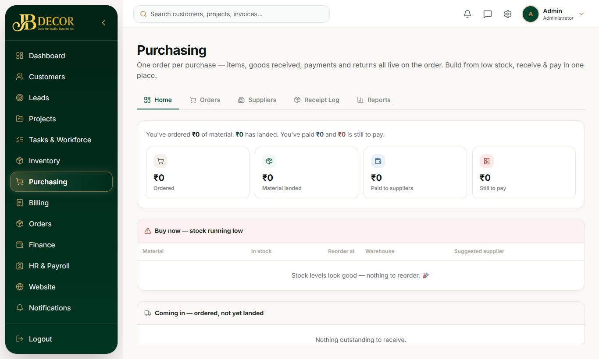
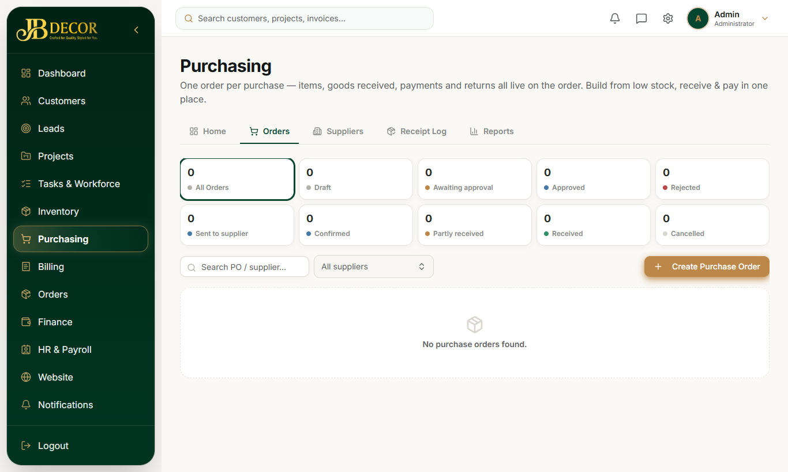
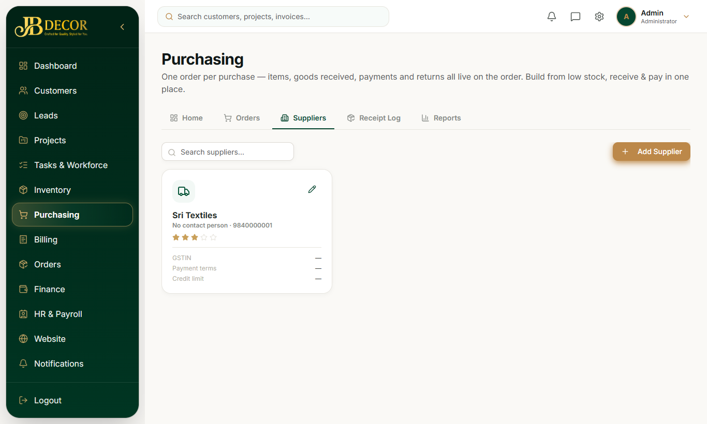

# Admin Guide — Purchasing

**Menu:** Purchasing (`PURCHASE_READ`) · **URLs:** `/purchases`, `/purchases/orders`, `/orders/new`, `/orders/:id`, `/suppliers`, `/suppliers/:id`, `/receipt-log`, `/reports`
**Related:** 08-inventory, 05-projects (Resources tab), 11-finance, employee/05-requests-and-field

## 1. Purpose
Buy materials from suppliers: purchase requests, purchase orders (PO), goods receipts (GRN), supplier bills, payments and returns.

<!-- screenshots -->

*Figure: Purchasing dashboard*

*Figure: Purchase orders*

*Figure: Suppliers*
<!-- /screenshots -->

## 2. Tabs and screens
- **Dashboard** – open POs, late deliveries, dues.
- **Purchase Orders** – list; **New PO** opens the PO builder (supplier, items, tax, discount, transport, delivery address list, optional project). PO detail page ("one order holds everything") shows items, shipments, receipts, bills and payments.
- **Suppliers** – directory; supplier profile has GSTIN, PAN, bank, credit terms, status, preferred products and history.
- **Receipt Log** – every goods-receipt approval with who approved it and from where (Desktop or Portal).
- **Reports** – purchase reports.

## 3. Status flow of a PO
DRAFT → PENDING_APPROVAL → APPROVED → SENT → CONFIRMED → PARTIAL → COMPLETED (or REJECTED / CANCELLED). "PARTIAL" means part of the goods arrived.

## 4. Step-by-step tasks

### Raise and send a PO
1. Purchasing → Purchase Orders → **New PO**.
2. Choose supplier, add items and delivery addresses. Save as draft.
3. Submit for approval → an approver approves → mark **Sent** to the supplier.

### Record a shipment and receive goods
1. PO detail → add a **shipment** (shipping ID, delivery place). One PO can have many shipments.
2. When goods arrive: Goods Received → verify items, enter accepted, damaged and rejected quantities, quality check result, photos.
3. Approve the receipt. Accepted quantity enters stock; damaged or rejected quantity does not.
4. A QC **Reject** blocks approval; raise a **purchase return** instead.

### Pay a supplier
Record a payment against the PO or bill: type ADVANCE, PARTIAL or FULL.

### Buy for a project
Project → Resources → Purchase Orders → **New PO** (project is pre-filled). Receipts appear in Goods Received on the same project.

## 5. Rules
- Receipts are accepted only while the PO is open (Approved, Sent, Confirmed or Partial).
- One shipping ID cannot be received twice on the same PO.
- A multi-line purchase request converts to one PO per preferred supplier.
- Approving a receipt updates the supplier's last purchase price and date and links the project's material requirement.
- Field employees can also receive and approve goods from the mobile portal; both routes are logged.

## 6. Common questions
**Q: Why can't I receive against this PO?** It is not in an open status (still Draft, or already Completed/Cancelled).
**Q: Where do I see who approved a receipt?** Purchasing → Receipt Log.
**Q: Goods came in two trucks.** Add two shipments on the PO and receive each.
