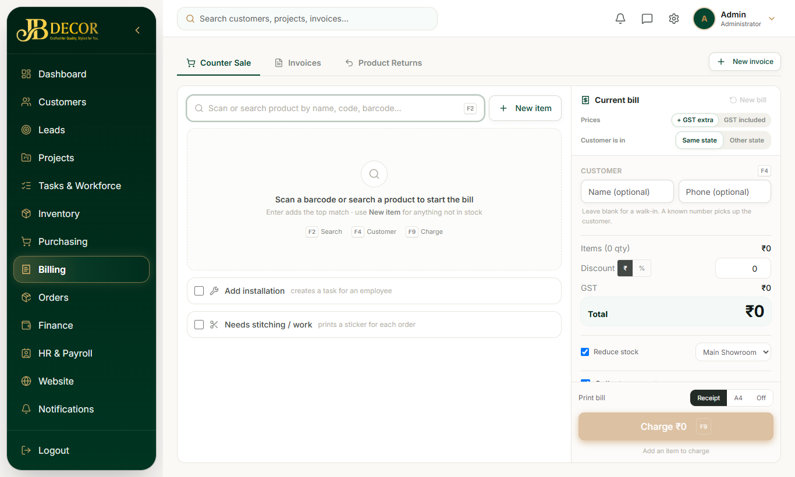
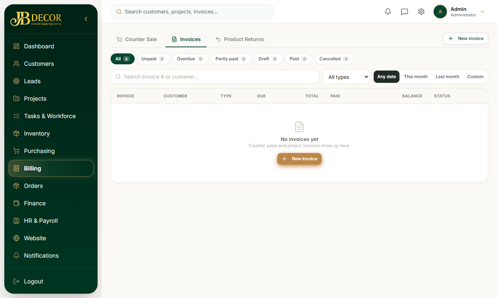

# Admin Guide — Billing (Counter Sale, Invoices, Returns)

**Menu:** Billing (`FINANCE_READ`) · **URLs:** `/billing/counter-sale`, `/billing/invoices`, `/billing/invoices/new`, `/billing/invoices/:id`, `/billing/returns`, `/billing/returns/new`
**Related:** 07-orders-bundles, 08-inventory, 11-finance, 05-projects

## 1. Purpose
Bill customers: walk-in product sales, project invoices, and product returns.

<!-- screenshots -->

*Figure: Counter sale*

*Figure: Invoices*
<!-- /screenshots -->

## 2. Tabs
- **Counter Sale** – a quick bill for walk-in customers (no project needed).
- **Invoices** – all invoices; create a project invoice; open detail to record payment, print, send or cancel.
- **Product Returns** – sales returns with refund (credit notes).

## 3. Step-by-step tasks

### Make a counter sale
1. Billing → Counter Sale.
2. Pick the customer (find by phone/email) or quick-add a walk-in with name and phone.
3. Add product lines; choose GST type (Same state / Other state).
4. Choose **GST extra** or **GST included**, **Same state** or **Other state**, discount in **₹** or **%**, and **Full** or **Advance** payment. Optional: tick **deduct stock** and warehouse; add an **installation** charge (an install task is created for an employee, or left in the pool); tick **needs work** for stitching/making to create order bundles.
5. Choose the payment method (**Cash, UPI, Card, Bank, Cheque**) and press **Charge** (shortcut F9) to mark it paid. Print as **Receipt** or **A4**.
6. Save. The invoice is created as Generated; stickers print if bundles were created.

### Create a project invoice
Invoices → New → pick customer/project, items or payment-schedule stage → save as Draft → Generate.

### Record payment
Invoice detail → Record payment (method, reference, proof). Payments collected by employees start as *Pending approval*.

### Return a product
Billing → Product Returns → New → choose invoice and items → process refund. Stock goes back to inventory.

### Cancel an invoice
Invoice detail → Cancel. Allowed for invoices with nothing paid; paid ones need a refund instead.

## 4. Rules
- Invoice status: DRAFT → GENERATED → SENT → PARTIAL / PAID / OVERDUE / CANCELLED. Issued invoices are immutable; only drafts can be edited.
- GST: discount applies before tax proportionally; CGST+SGST for same state, IGST for other state; round-off line added.
- Every posting goes to an immutable customer ledger; corrections are reversal entries.
- A default 8-stage payment schedule can be attached to projects; progress-linked stages auto-invoice (see 05-projects).
- Invoice customer segment: **Walk-in** vs **Project Client** customers are kept separate in the Customers tab.

## 5. Common questions
**Q: Where did the Invoices menu go?** It moved from Finance to Billing.
**Q: Stock did not drop after a sale.** "Deduct stock" was off or the line had no catalogue product.
**Q: Customer paid at site.** The employee's cash entry appears as Pending approval under project Payments; approve it.
