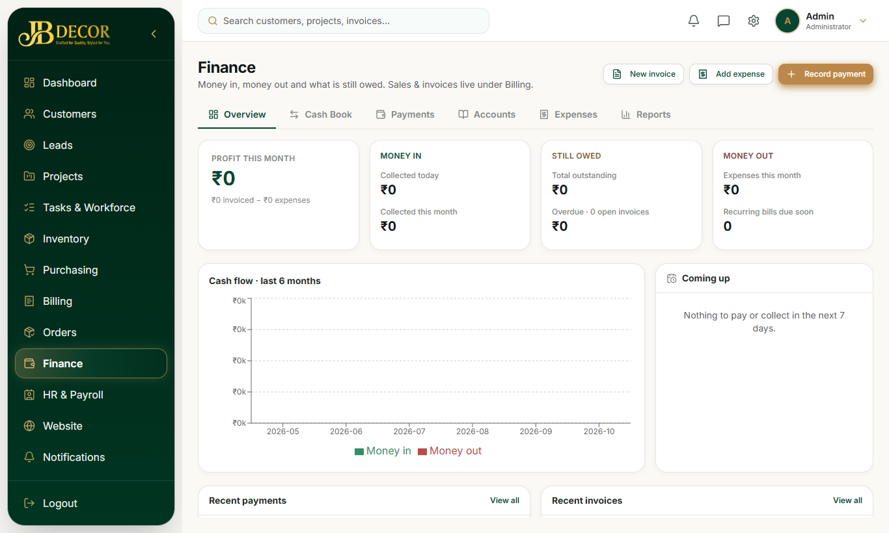
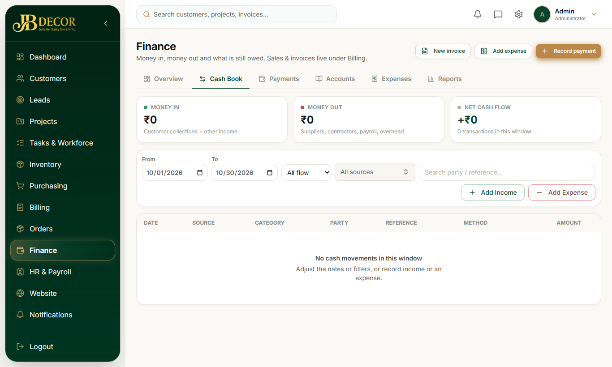

# Admin Guide — Finance

**Menu:** Finance (`FINANCE_READ`) · **URLs:** `/finance`, `/finance/payments`, `/cashbook`, `/accounts` (also `/outstanding`, `/ledger`, `/profitability`), `/expenses`, `/reports`
**Related:** 10-billing, 09-purchasing, 12-hr-payroll, 13-contractors, 05-projects

## 1. Purpose
See all money in and out of the company in one place and approve what needs approval.

<!-- screenshots -->

*Figure: Finance dashboard*

*Figure: Cash Book*
<!-- /screenshots -->

## 2. Tabs
- **Overview** – tiles: Collected today, Collected this month, Total outstanding, Overdue invoices, Expenses this month, Recurring bills due soon; buttons **New invoice**, **Add expense**, **Record payment**; shortcut tiles to Refunds, Project expenses, Recurring bills, Invoices, Counter sale, Product returns, Cash book, Revenue & expense, Profit & loss, GST report and Cash flow.
- **Payments** – customer payments with Approve/Reject for pending ones.
- **Cash Book** – one register merging every income and expense source. **Add Income** / **Add Expense** record company-level items (interest, scrap sale, rent, utilities, marketing, other charges) that do not belong to a project.
- **Accounts** – customer balances, ledger entries (outstanding, ledger, profitability views).
- **Expenses** – project expenses.
- **Reports** – finance and P&L reports (also reachable from the Reports hub).

## 3. What flows into the Cash Book
- **Money in:** confirmed customer payments, company income.
- **Money out:** supplier payments, contractor payments, salaries marked paid, manual project expenses, company expenses.
- Synced purchase/contractor expenses are not double counted.

## 4. Step-by-step tasks
### Approve a pending payment
Finance → Payments → filter Pending approval → Approve or Reject.
### Record an overhead expense
Cash Book → Add Expense → category, amount, date, notes. Leave project blank for overhead.
### Check a project's profit
Finance → Profitability → choose project. Shows cash basis (customer paid minus costs paid) and invoiced basis.
### Handle a refund
Refund moves Pending → Approved → Paid and posts to the ledger (used by project cancellation and product returns).

## 5. Rules
- Permissions: FINANCE_READ, WRITE, APPROVE, COLLECT.
- Ledger is append-only; corrections are reversals.
- Project expenses auto-sync from purchase bills, inventory consumption and contractor payments.
- Profit & loss is cash-basis.

## 6. Common questions
**Q: Where do I enter rent or electricity?** Cash Book → Add Expense.
**Q: A salary is missing from the Cash Book.** It appears only after the payslip is marked Paid.
**Q: Reports tab missing from Finance.** Use `/finance/reports` or the Reports hub.
