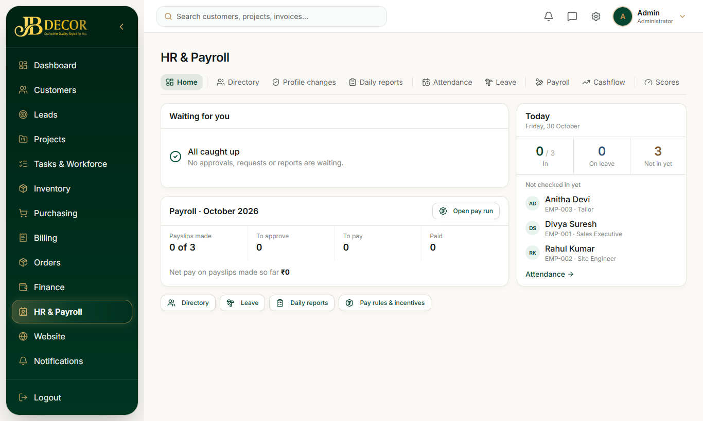
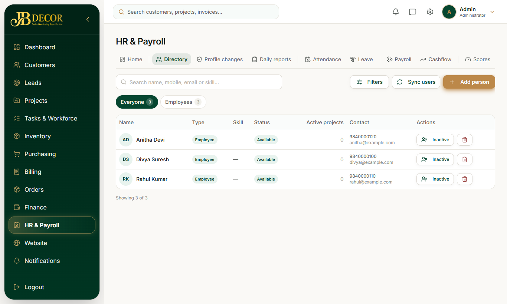
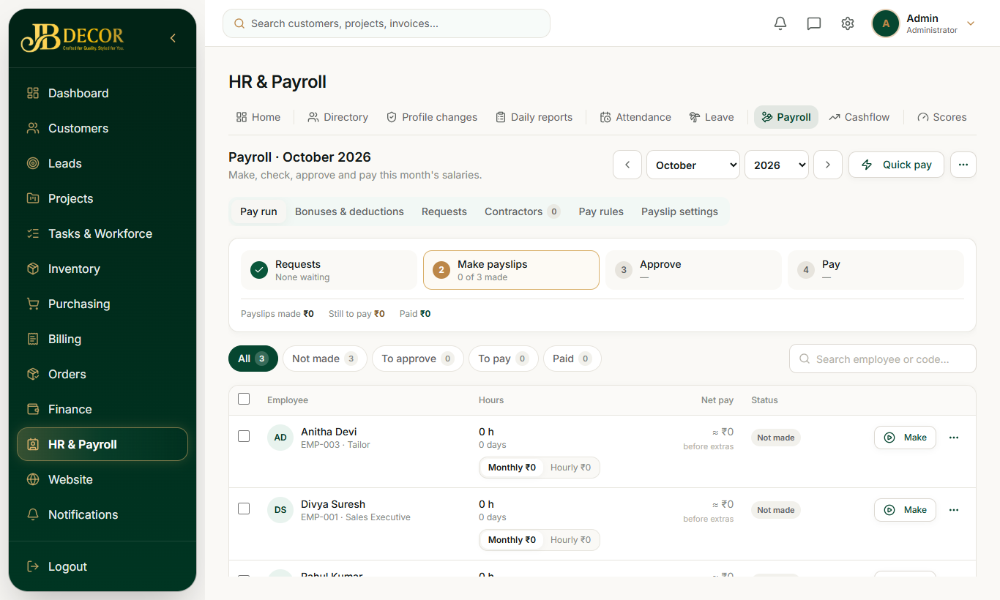
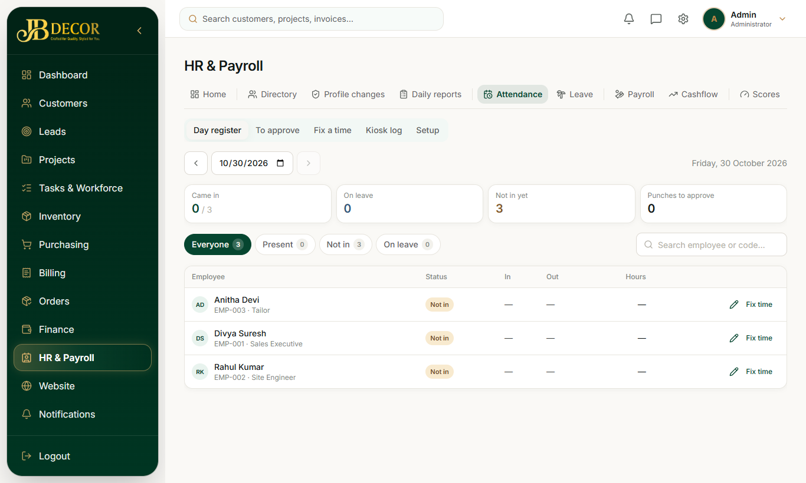
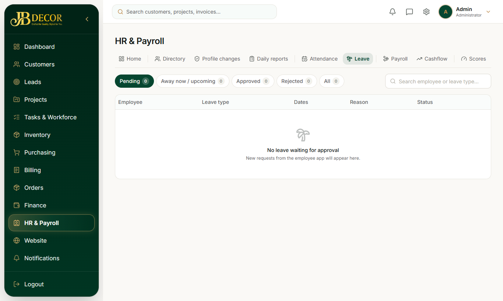

# Admin Guide — HR & Payroll (Workforce)

**Menu:** Workforce (`WORKFORCE_READ`) · **URLs:** `/workforce` (home), `/workforce/people`, `/payroll`, `/cashflow`, `/attendance`, `/daily-reports`, `/leave`, `/departments`, `/performance`, `/review-rewards`, `/approvals`, `/reports`, `/workforce/:id`, `/hr/payslip/:id`; kiosk at `/kiosk`
**Related:** employee/01-home-and-attendance, employee/04-profile-pay-leave, 11-finance, 13-contractors

## 1. Purpose
Manage employees and contractors as one workforce: profiles, attendance, leave, daily reports, performance and monthly pay.

<!-- screenshots -->

*Figure: HR home*

*Figure: People directory*

*Figure: Payroll*

*Figure: Attendance*

*Figure: Leave*
<!-- /screenshots -->

## 2. Screens
- **HR Home** (`/workforce`): *Waiting for you* (approvals), *Today*, *Payroll* summary. Users without HR rights see the directory instead.
- **Directory** (`/workforce/people`): Everyone / Employees / Inactive; **Filters**, **Sync users**, **Add person**. Open a profile (6 tabs) for details, documents, wage and basis, attendance method, face enrolment, review QR, performance.
- **Profile changes**: employee profile edits and photos awaiting approval.
- **Daily reports**: reports employees submit, with cash collected. Approve or Reject.
- **Attendance** tabs: **Day register**, **To approve**, **Fix a time**, **Punch log**, **Kiosk log**, **Setup** (office locations, methods, kiosks).
- **Leave**: approve or reject (Reject exists).
- **Departments**.
- **Scores**: auto performance score cards.
- **Review rewards**: customer Google-review rewards.
- **Payroll** tabs: **Pay run**, **Bonuses & deductions**, **Requests**, **Contractors**, **Pay rules**, **Payslip settings**; a **Quick pay** button. HR Home also has **Open pay run** and **Pay rules & incentives**.
- **Cashflow**, **Reports**.

## 3. Step-by-step tasks

### Run payroll for a month
1. HR & Payroll → Payroll → Pay run. Pick the period (prev/next).
2. Follow the step bar: **1 Requests → 2 Make payslips → 3 Approve → 4 Pay**. Filter chips: All, Not made, To approve, To pay, Paid.
3. For each person choose **Monthly** or **Hourly** (shown with the amount) and press **Make**.
4. Tick rows for bulk Make / Approve / Pay, or use the row's next-step button. Use *Edit* to adjust.
5. Open a payslip to add named lines (earnings such as incentive, bonus, allowance; deductions such as penalty, extra repayment). A paid payslip is locked.
6. Unpaid payslips can be deleted or regenerated; deleting reverses bonuses, deductions and requests.

### How pay is calculated
- Always from attendance hours. Standard hours = daily standard hours × 26.
- **Hourly:** regular hours × hourly rate (or monthly salary ÷ standard hours if no rate) + overtime.
- **Monthly:** monthly salary ÷ standard hours × regular hours, capped at the monthly salary, + overtime.
- Approved bonuses, deductions, advance/loan recovery and requests are included.
- Automatic lines: Google-review rewards and qualified-lead rewards (rate set in Website → Settings; 0 = off).
- Open sessions with no check-out on a past day are **not paid** until HR sets the check-out.

### Fix attendance
Attendance → Fix a time → pick employee/day → set check-in/out. Setting a missed check-out approves it automatically. Flagged punches appear in *To approve*.

### Set the attendance method
Profile or Setup: per employee **GEO** (inside office radius), **OFFICE_DEVICE** or **ANY**. Soft enforcement: a failed check never blocks clock-in, it flags the punch for HR. One phone per user: the first device is auto-approved; changes need HR approval.

### Office face kiosk
Attendance → Setup → add a kiosk → give the 8-character code (valid 24 h) → open `/kiosk` on the shared phone and enter it. Enrol 5 face samples on each employee profile. Punch outcomes: checked in/out, already in, not in, too soon (<2 min), not recognised, ambiguous. Weak matches are flagged for HR.

### Employee review QR
Each profile shows a QR to the public review page; customers rate and are redirected to the Google review link set in Website → Settings.

## 4. Performance score
0–100 from attendance (40%, last 90 days), tasks (35%, completion and punctuality), reviews (25%). Missing signals are dropped and weights rebalanced. Grades A ≥85, B ≥70, C ≥55, else D.

## 5. Rules
- Roles: Admin or Employee accounts only; HR rights come from permissions (`WORKFORCE_*`, `PAYROLL_READ/WRITE/PROCESS`).
- Contractors appear on the pay run for visibility only; pay them through Contractor bills (approval ladder), not inline.
- Employees see only Approved or Paid payslips.

## 6. Common questions
**Q: A day shows no pay.** The session has no check-out; fix it in Attendance.
**Q: Reward line missing from payslip.** Check the reward rate in Website → Settings and that the lead is qualified.
**Q: Employee can't clock in.** Check attendance method, device approval, or office location radius in Setup.
