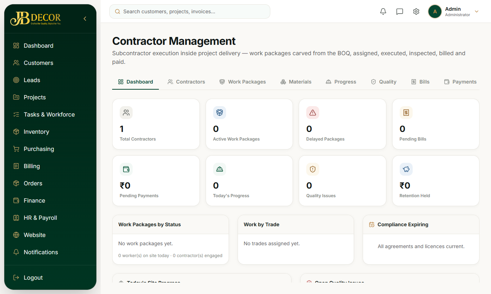
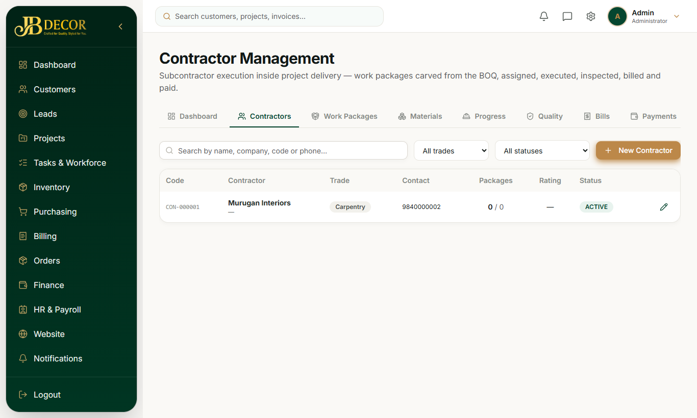

# Admin Guide — Contractors

**Menu:** reached via `/contractors` (`CONTRACTOR_READ`) · **URLs:** `/contractors` (dashboard), `/directory`, `/work-packages`, `/materials`, `/progress`, `/quality`, `/bills`, `/payments`, `/ledger`, `/reports`; details `/directory/:id`, `/work-packages/:id`, `/bills/new`, `/bills/:id`
**Related:** 05-projects, 11-finance, 12-hr-payroll

## 1. Purpose
Hire outside contractors for parts of a project and pay them only for approved, measured work.

<!-- screenshots -->

*Figure: Contractor dashboard*

*Figure: Contractor directory*
<!-- /screenshots -->

## 2. Core rule
A contractor never receives a whole project. Work goes to them as a **work package**: Project → Phase → Room → quote items → Work Package → Contractor. A quote item can sit in only one live package, which prevents paying the same scope twice.

## 3. Tabs
Contractors (directory) · Work Packages · Materials (issued to contractors) · Progress (daily) · Quality (inspections) · Bills · Payments · Ledger · Reports.
Contractors can also log in to their own portal (`ROLE_CONTRACTOR`) to see their packages and bills.

## 4. Step-by-step tasks
### Add a contractor
Directory → add: name, trade, GSTIN, PAN, bank/UPI, documents with expiry and verification.
### Give work
Work Packages → New → choose the project (required) and quote items → set rate and assign contractor → approve.
### Track and inspect
Record daily progress (workers, hours, photos) and quality inspections against the package.
### Issue materials
Materials tab → issue stock to the package.
### Bill and pay
1. Bills → New → select package and measured quantities.
2. The bill goes through the approval ladder: engineer → project manager → finance.
3. Payments → record payment (advance/partial/full, TDS). It posts to the contractor ledger and the project's costs.

## 5. Rules
- Creating a package without a project is refused.
- Bills need the full approval ladder; contractors show on payroll only as links.
- Permissions: `CONTRACTOR_READ/WRITE/PAYMENT`, `WORK_PACKAGE_READ/WRITE/ASSIGN/APPROVE/EXECUTE`.
- If a quote changes after packages exist, packages are reconciled with the new revision.

## 6. Common questions
**Q: Can't add this quote item to a package.** It is already in another live package.
**Q: Where is a contractor's balance?** Ledger tab or the contractor's detail page.
