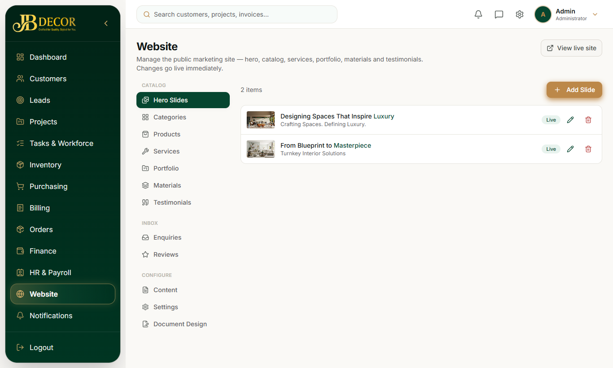
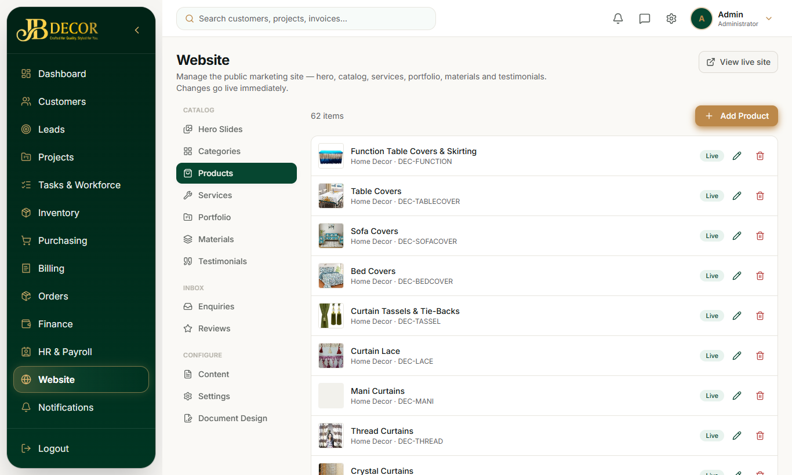
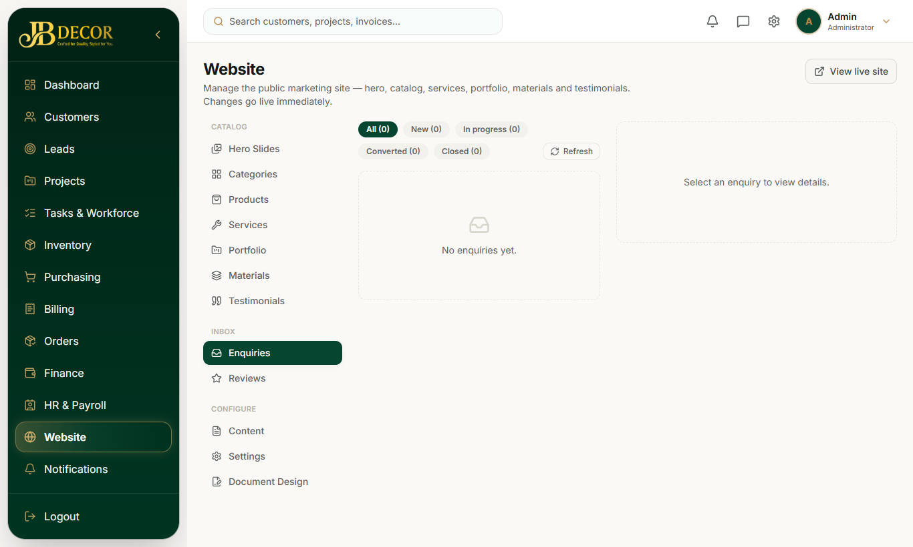
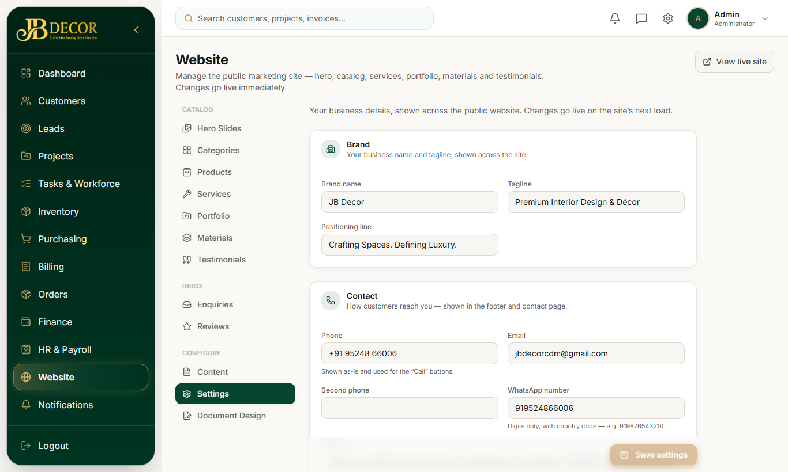

# Admin Guide — Website CMS

**Menu:** Website (`WEBSITE_READ`; edit needs `WEBSITE_WRITE`, Admin by default) · **URLs:** `/website` and sub-pages
**Related:** website/01-browsing-and-enquiry, 02-leads

## 1. Purpose
Edit the public JB Decor website from the CRM. Changes go live on the next page load of the public site.

<!-- screenshots -->

*Figure: Hero slides*

*Figure: Products*

*Figure: Enquiries inbox*

*Figure: Website settings*
<!-- /screenshots -->

## 2. Tabs
- **View live site** button; **Add Slide**; tabs **Hero Slides** (home banner) · **Categories** · **Products** (catalogue with colour variants) · **Services** · **Portfolio** · **Materials** (finishes) · **Testimonials**
- **Enquiries** – the inbox for website forms.
- **Content** – page text blocks (home, about, contact intro, etc.).
- **Reviews** – moderate customer and employee reviews (approve or hide).
- **Settings** – brand name, tagline, contact details, social links, Google review link, lead reward amount, warranty months.
- **Document Design** – look of printed documents (quote, invoice).

Edit forms are compact single-screen layouts with a **live preview** of how it will look on the site.

## 3. Step-by-step tasks
### Add a product
Products → Add → choose category, name, description, images, colour variants → set active → Save. Toggle active to hide without deleting.
### Handle an enquiry
1. Enquiries inbox: channels are Contact, Consultation, Product quote. Status: NEW → IN_PROGRESS → CONVERTED / CLOSED.
2. Open it, set status, and press **Convert to lead**. The full lead workflow starts (idempotent: converting twice does not duplicate).
3. A task is also created for each new enquiry and admins are notified.
### Change contact details
Settings → edit phone, email, WhatsApp, address, hours, social → Save.
### Moderate reviews
Reviews → Hide or Approve each one.

## 4. Rules
- The site is a **catalogue plus enquiry** site (Category → Products → colours). Cart, checkout, wishlist and customer self sign-up are switched off.
- Site values overlay built-in defaults, so a page is never empty if a setting is blank.
- Deleted items are soft-deleted; slugs must be unique.
- Sitemap and SEO pages are generated from live data.

## 5. Common questions
**Q: Order tabs disappeared.** Replaced by the Enquiries inbox.
**Q: Image not showing.** Re-upload through the field; images are stored on the server or cloud storage.
**Q: Where do I set the Google review link?** Settings → `google_review_url`.
