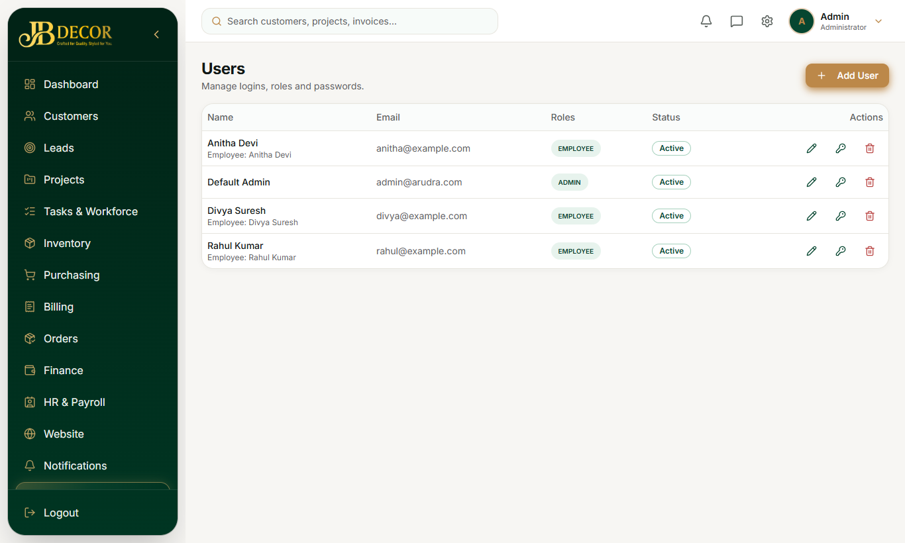
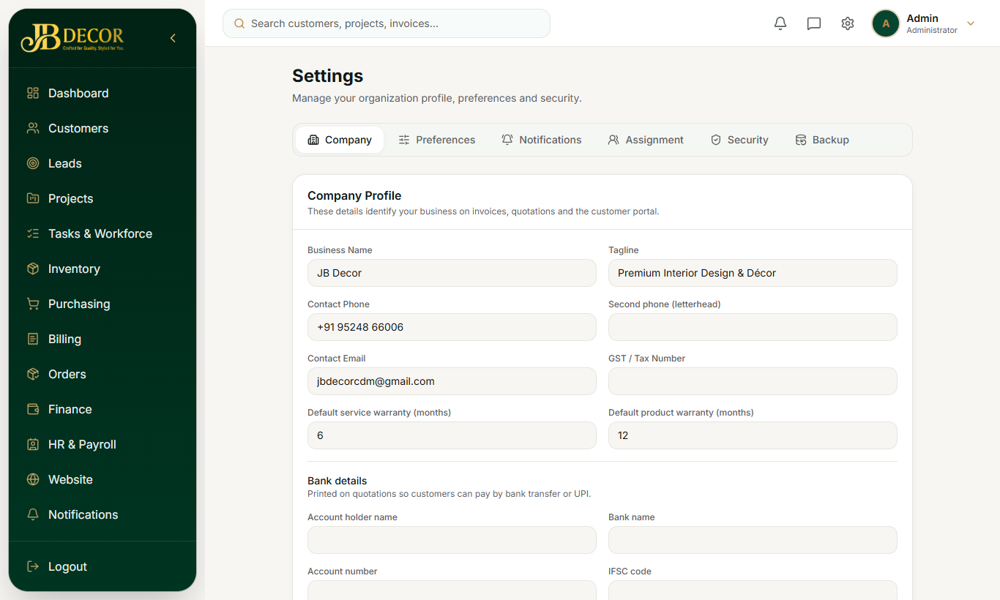

# Admin Guide — Users, Roles & Settings

**Menu:** Users (admin only) and Settings · **URLs:** `/users`, `/settings`
**Related:** 01-dashboard-and-navigation, 12-hr-payroll

## 1. Account types
| Type | What it means |
|---|---|
| **Admin** | Full desktop access |
| **Employee** | Mobile portal; limited desktop pages for lead work only |
| **Customer / Contractor** | Portal roles, created by admin |

Fine-grained permissions (e.g. `LEAD_READ`, `FINANCE_WRITE`, `PAYROLL_PROCESS`) decide which menus and buttons appear.

<!-- screenshots -->

*Figure: Users*

*Figure: Settings*
<!-- /screenshots -->

## 2. Users page
Fields when creating: Name, Email, Phone (optional, for phone sign-in), Temporary password, **Account type**.
Actions: edit, **reset password** (admin sets any password, no OTP needed), **unlock** a locked account, delete.

## 3. Settings page (cards)
Cards: **Company · Preferences** (language, theme) **· Notifications · Assignment** (task allocation rules, max tasks per day) **· Security · Backup**. The Backup card has **Database backup** (a full copy downloaded to your computer; nothing is stored on the server) and **Uploaded files** (download photos, documents, recordings). Press **Save Changes** after editing. Users page has **Add User**.

## 4. Step-by-step tasks
### Create a login for a new employee
Users → Add → name, email, temporary password, Account type = Employee → Save. The employee is forced to change the password on first login.
### Reset a forgotten password
- Self-service: login page → **Forgot password** → enter email → 6-digit code (valid 10 minutes) → new password.
- Admin: Users → row → Reset password.
### Unlock an account
Repeated wrong passwords lock it; Users → Unlock.
### Back up data
Settings → Database backup → download.

## 5. Rules
- Sign-in happens on the public website `/login`; there is no separate CRM login page.
- A login returning 403 usually means the account email is not verified (treated as disabled).
- Refresh tokens rotate; a password change is forced for temporary passwords.

## 6. Common questions
**Q: I never got the reset code.** Check spam; if email is not configured the code only appears in server logs, so ask the admin to reset it.
**Q: Employee sees nothing on desktop.** By design they use `/employee`.
