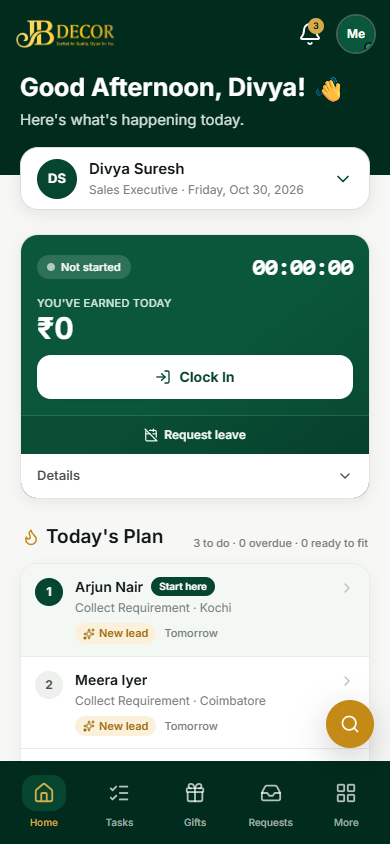
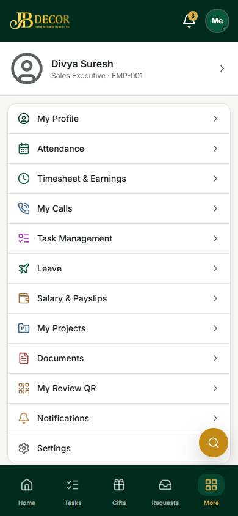
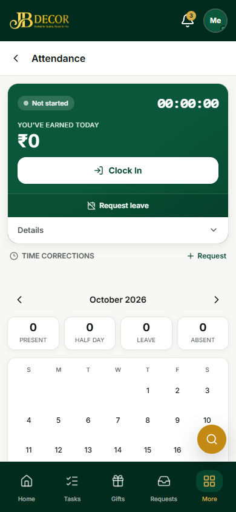
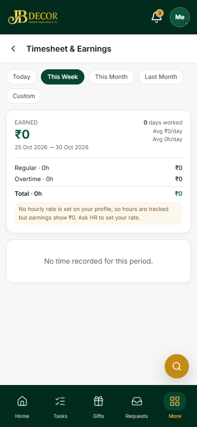
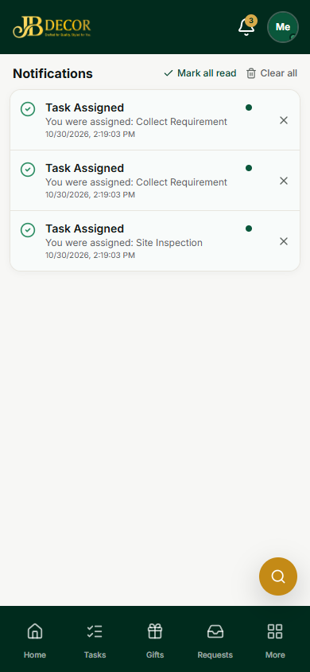

# Employee Guide — Home, Attendance & Navigation

**App:** Employee mobile portal · **URLs:** `/employee`, `/employee/attendance`, `/employee/timesheet`, `/employee/notifications`, `/employee/search`, `/employee/more`
**Who uses it:** every employee. Open it on your phone browser; you can add it to your home screen.

## 1. What you see
The bottom bar has five tabs: **Home**, **Tasks**, **Gifts**, **Requests**, **More**. The top bar has a notification bell and your profile button ("Me"). A round gold **search** button floats at the bottom right.

*Figure: Home with the clock-in card and Today's Plan*

*Figure: More menu (profile, attendance, timesheet, calls, leave, salary, documents, review QR, settings)*

## 2. Screens
- **Home** – greeting, **clock card** (Not started / working timer, "You've earned today", **Clock In**, **Request leave**), a *Details* drop-down, and **Today's Plan** (your next tasks in order, with "Start here").
- **Attendance** – the clock card again, **Time corrections** (ask HR to fix a missed punch), and a month calendar with counts: Present, Half day, Leave, Absent.
- **Timesheet & Earnings** – pick **Today / This Week / This Month / Last Month / Custom**. Shows days worked, regular hours, overtime and weekend earnings, and pending hours.
- **Notifications** – tasks assigned, approvals, leave and payslip decisions. **Mark all read** or **Clear all**.
- **Search** – type at least 2 characters (customer name or number, project, shipping ID, order code).

*Figure: Attendance*

*Figure: Timesheet & Earnings*

*Figure: Notifications*

## 3. Step-by-step tasks
### Clock in and out
1. Open **Home** (or Attendance).
2. Tap **Clock In**. Allow location if the phone asks.
3. Your timer and earnings start. Tap **Clock Out** at the end of the shift. You may clock in and out several times in a day; hours are added together.
4. If HR set a check method for you, the app may ask for a face or fingerprint check, or may only accept punches at the office location. A failed check does not stop you; the punch is sent to HR to approve.

### Punch at the office kiosk
Some offices have a shared phone (the kiosk). Stand in front of it; it recognises your face and says whether you are checked in or out.

### Fix a forgotten punch
Attendance → **Time corrections → Request**, enter the right time and a reason. HR approves it. Until then, a day with no check-out is **not paid**.

### See what you earned
More → **Timesheet & Earnings**, choose the period.

## 4. Rules
- Only one phone is linked to your attendance. If you change phones, ask HR to approve the new one.
- Clock-ins from far outside the office location are flagged for HR.
- Notifications go only to you.

## 5. Common questions
**Q: Clock In does nothing.** Check internet and location permission. If you are offline, the action waits in the offline list (cloud icon at the top) and sends when you are back online.
**Q: My day shows ₹0.** You did not clock out, or no hourly rate is set on your profile. Ask HR.
**Q: How do I ask for leave?** Home → **Request leave**, or More → Leave (see guide 04).
