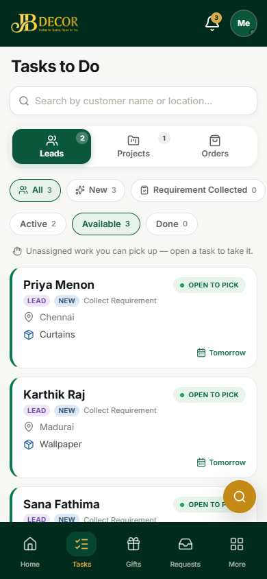
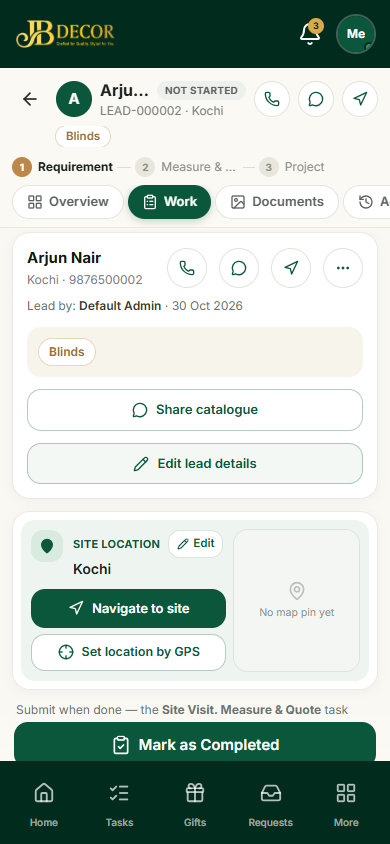
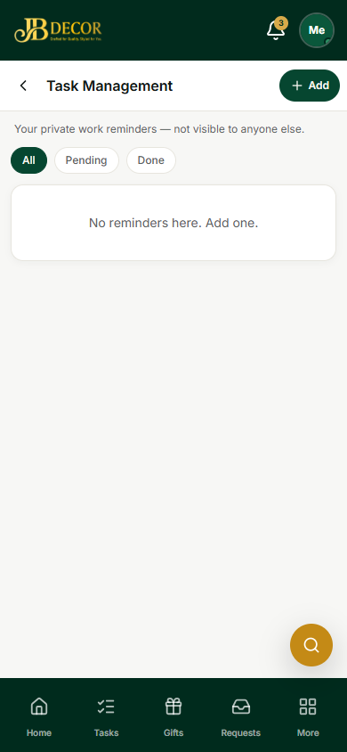

# Employee Guide — Tasks

**URLs:** `/employee/tasks`, `/employee/tasks/:id`, `/employee/task-management`
**Related:** 03-lead-work, admin/06-tasks

## 1. What tasks are
Everything you must do comes as a task: collect a lead's requirement, visit and measure a site, make a quote, work on a project, install, or follow up a call. Admin or the system assigns tasks; some are open for anyone to **pick**.

*Figure: Tasks to Do*

## 2. Screens
- **Tasks to Do** – three lanes at the top: **Leads**, **Projects**, **Orders** (with counts). Filters: **All / New / Requirement Collected**, and **Active / Available / Done**. A card shows the customer, task name, city, product and due date. **Open to pick** means anyone eligible can take it.
- **Task detail** – customer card with call, WhatsApp and navigate buttons; tabs **Overview, Work, Documents, Activity**; site location with **Navigate to site** and **Set location by GPS**; and the bottom button (for example **Mark as Completed**).
- **Task Management** – your private reminders (not visible to anyone else): All / Pending / Done, **Add**.

*Figure: Task detail*

*Figure: Task Management (private reminders)*

## 3. Step-by-step tasks
### Pick an available task
Tasks → **Available** → open the card → **Pick / Start**. It moves to **Active**.

### Do a lead task (Collect Requirement)
1. Open the task and fill the requirement form: category (one or more), products, budget, property details, photos and voice note.
2. You can **Edit lead**, **Set location by GPS** (fills the address), and take or upload photos to the lead.
3. When the requirement reaches at least 10%, the task can be completed. Save, then **Mark as Completed**. The next task (Site Visit & Measurement) appears.
If the customer is not ready, choose **Follow up later** with a date and time.

### Work on a project task
Project tasks are **shared**: **Project Execution** and **Installation**. Tap **Join**, then:
- **Products / Checklist** – tick steps (material, manufacture, stitching, delivery).
- **Daily log** – write what you did today and add photos.
- **Team chat** – message the team, tag a product line, attach a photo.
- Set the % complete. The **Installation** task is the closing task and needs admin approval.

### Finish a call follow-up
Call tasks cannot simply be completed; choose an outcome (create lead, attach to a lead, or not a lead).

## 4. Rules
- Tasks of a lead disappear from your list after the lead is converted or past the quote stage.
- Tasks must be done in order for a lead: Collect Requirement → Site Visit & Measurement → BOQ & Quotation.
- Project tasks are closed automatically when the project is completed, handed over or cancelled.
- Some completions wait for **admin approval**; you will get a notification.

## 5. Common questions
**Q: I cannot see a task someone told me about.** It may not be assigned yet; check **Available**, or ask admin to assign it.
**Q: Mark as Completed is disabled.** A required step is missing (checklist, requirement %, or photos). Open the task and look for the highlighted item.
**Q: Where are my private reminders?** More → Task Management.
