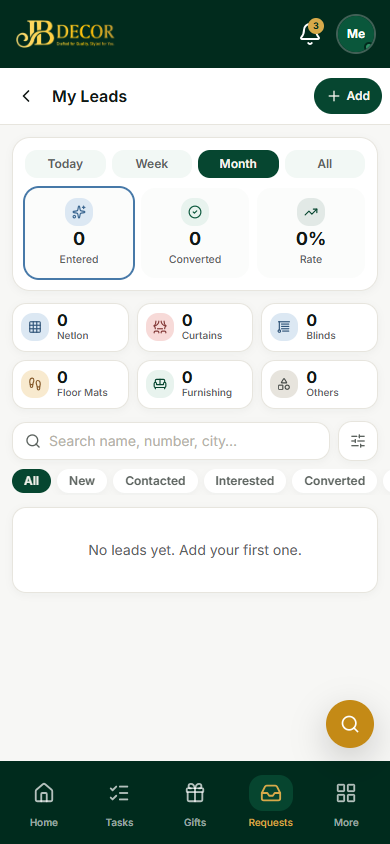
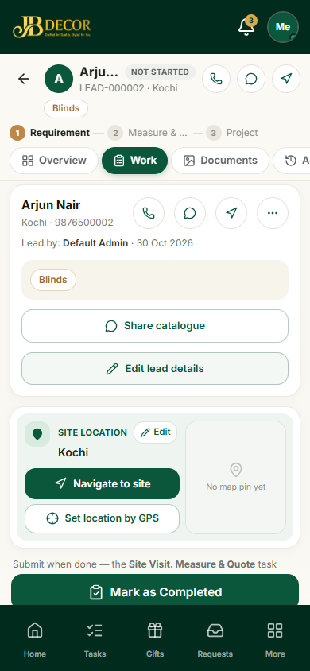

# Employee Guide — Leads, Site Visit, Measurement & Quote

**URLs:** `/employee/leads`, `/employee/lead/:leadId`, `/employee/visit-measure/new`, `/employee/quote/new`
**Related:** 02-tasks, admin/02-leads, admin/04-site-visit-measurement-quote

## 1. What it is for
Add new customer leads you meet, collect their requirements, visit the site, measure, price a quote, and ask admin to create the project when the customer agrees.

*Figure: My Leads*

*Figure: Lead workspace*

## 2. Screens
- **My Leads** – cards of your leads with filters **Today / Week / Month / All**, status chips (New, Contacted, Interested, Converted), category counts, search, and **Add**.
- **Add Lead sheet** – 6 steps: Customer, Looking for, Visit & budget, Contact, Requirement & notes, Photos. Tag the enquiry as **Product**, **Service** or **Others**.
- **Lead workspace** – header with call, WhatsApp and navigate; progress **Requirement → Measure & Quote → Project**; tabs **Overview, Work, Documents, Activity**; **Share catalogue**, **Edit lead details**, site location with **Navigate to site** and **Set location by GPS**.
- **Site Visit & Measurement / Quote** – a mobile quote workspace: rooms and sizes, price lines by category and product, discount, labour and shipping.

## 3. Step-by-step tasks
### Add a lead
1. Requests → **My Leads → Add**.
2. Fill name and phone first. Pick the enquiry tag and categories.
3. Add photos or a voice note if you have them. Tap **Submit**.
4. Admin is notified and a Collect Requirement task is created.

### Measure and quote
1. From the task, open the lead workspace → **Work**.
2. Add rooms and sizes (choose from the standard item list).
3. Add price lines (category → product, colour, qty, rate, discount), then labour and shipping.
4. Generate the quotation and show or share it with the customer.

### Customer agreed → create project
1. When the customer agrees, tap **Customer Agreed / Convert** and then **Send for Approval**.
2. Advance money is optional: enter amount, method, reference and a photo of the receipt.
3. The button then says **Waiting for admin approval**. Admin approves, or rejects with a reason and the quote reopens as a new revision.
You cannot create a project yourself.

## 4. Rules
- You see and edit only leads assigned to or created by you.
- A lead you add may be held for about 10 minutes for data entry before others can pick it.
- Photos are cropped, rotated and compressed automatically before upload.

## 5. Common questions
**Q: The map pin is missing.** Tap **Set location by GPS** while standing at the site.
**Q: I made a mistake in the lead.** Tap **Edit lead details**, correct, and save; it does not complete the task.
**Q: Admin rejected my project request.** Open the lead; the quote is back in edit mode. Fix and send again.
