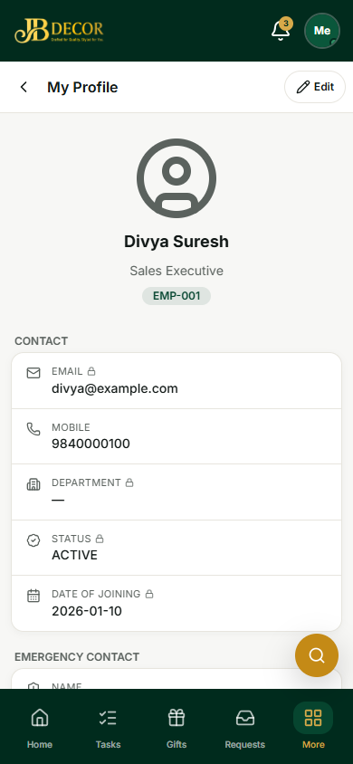
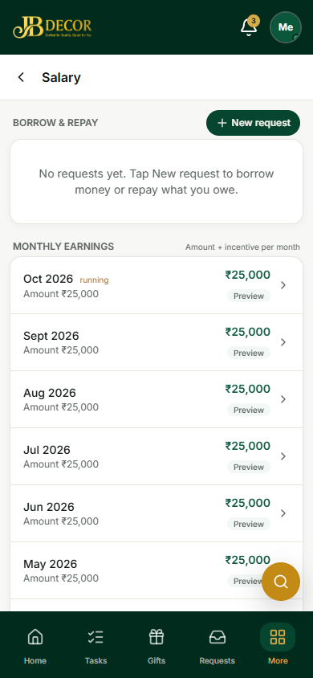
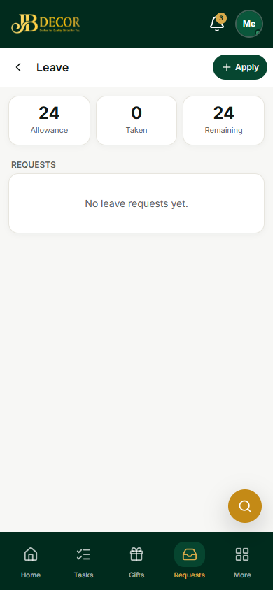
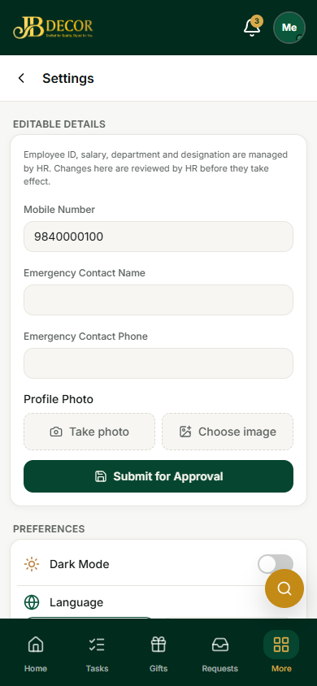
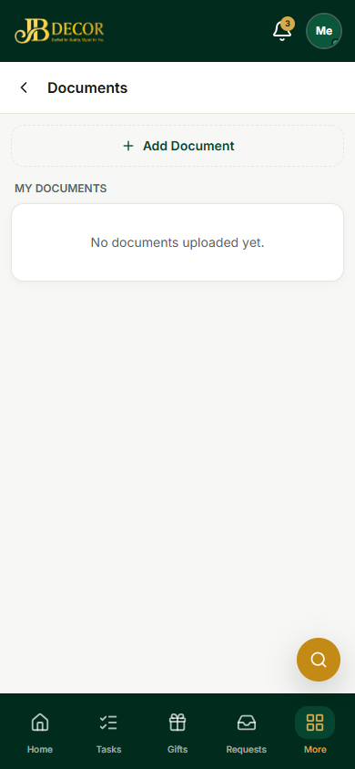
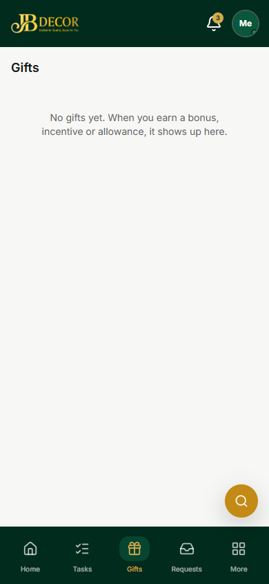

# Employee Guide — Profile, Salary, Leave & Gifts

**URLs:** `/employee/profile`, `/documents`, `/salary`, `/leave`, `/gifts`, `/settings`

*Figure: My Profile*

*Figure: Salary & payslips*

*Figure: Leave*

## 1. Screens
- **My Profile** – your details. Items with a lock (email, department, status, joining date) are managed by HR.
- **Settings** – editable details (mobile number, emergency contact, **profile photo**), then preferences: **Dark mode** and **Language** (English, Hindi, Tamil, Telugu).
- **Documents** – upload your own documents (ID, certificates).
- **Salary & Payslips** – **Borrow & Repay** (advances and loans), **Monthly earnings** with a preview for the running month, and payslips once approved.
- **Leave** – shows **Allowance, Taken, Remaining** and your requests; **Apply**.
- **Gifts** – bonuses, incentives and allowances you earned appear here with a small celebration.

*Figure: Settings*

*Figure: Documents*

*Figure: Gifts*

## 2. Step-by-step tasks
### Change my photo or phone number
Settings → edit the field or **Take photo / Choose image** → **Submit for Approval**. Until HR approves, the app shows your pending photo on your phone.

### Apply for leave
Leave → **Apply** → dates, type, reason → submit. HR approves or rejects; you are notified.

### Read my payslip
Salary → pick the month → open. You see only **Approved** or **Paid** payslips. The slip shows attendance pay, overtime, named bonuses and incentives (for example Google review rewards, qualified-lead rewards) and deductions. You can print or save it as PDF.

### Ask for an advance or loan
Salary → **Borrow & Repay → New request**. HR approves; repayment is recovered from future payslips.

### Upload a document
Documents → **Add Document**.

## 3. Rules
- Payslip pay is always calculated from your attendance hours (hourly or monthly basis chosen by HR at payslip time).
- Days with no check-out are not paid until HR corrects them.
- Profile changes (photo, phone) need HR approval.

## 4. Common questions
**Q: I cannot see this month's payslip.** It is shown only after HR approves it. The running month shows a preview.
**Q: Why is a reward line on my payslip?** Customer Google review rewards and qualified lead rewards are added automatically.
**Q: Change language?** Settings → Language.
