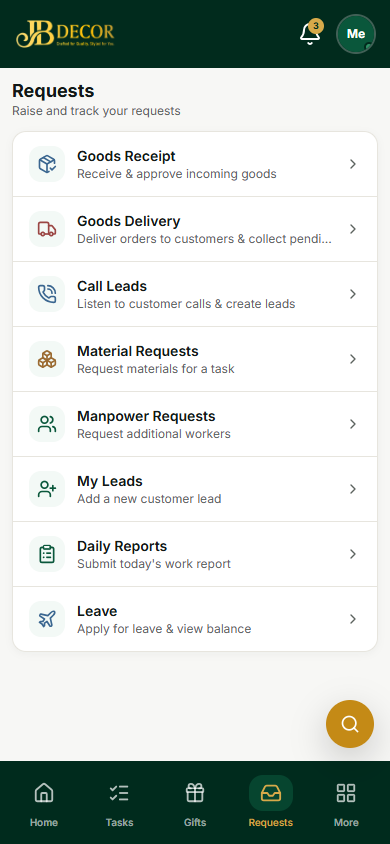
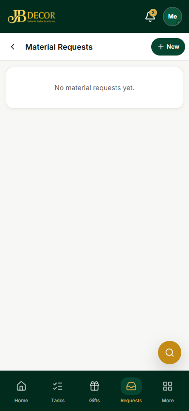
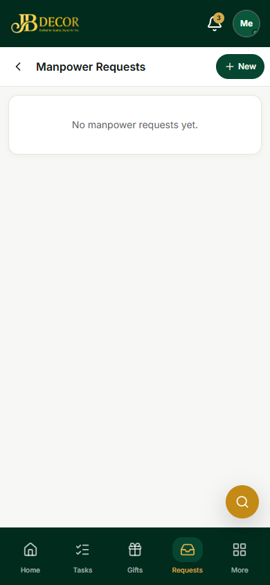
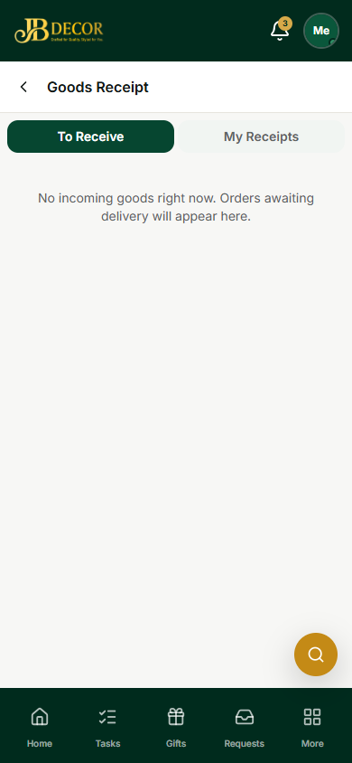
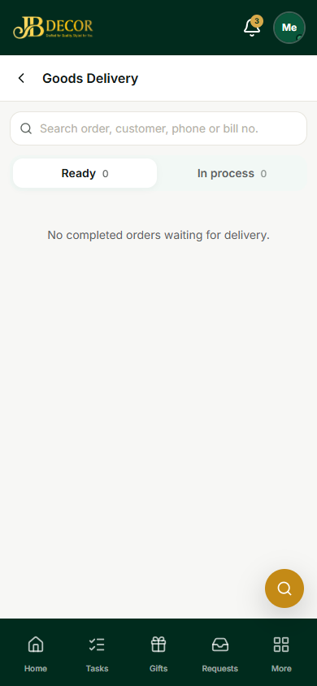
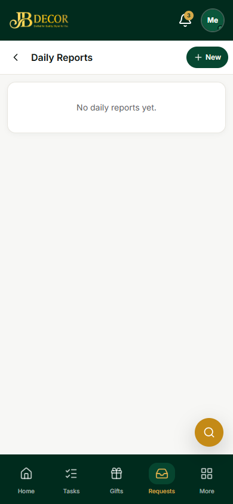

# Employee Guide — Requests, Goods Receipt, Delivery & Daily Reports

**URLs:** `/employee/requests`, `/requests/material`, `/requests/manpower`, `/goods-receipts`, `/deliveries`, `/daily-reports`

*Figure: Requests hub*

## 1. The Requests tab
A list of everything you can raise or do: **Goods Receipt**, **Goods Delivery**, **Call Leads**, **Material Requests**, **Manpower Requests**, **My Leads**, **Daily Reports**, **Leave**.

*Figure: Material Requests*

*Figure: Manpower Requests*

*Figure: Goods Receipt*

*Figure: Goods Delivery*

*Figure: Daily Reports*

## 2. Step-by-step tasks
### Ask for materials for a task
Requests → **Material Requests → New** → pick the task or project, add materials and quantity → submit. The project manager and admin are notified and approve.

### Ask for more workers
Requests → **Manpower Requests → New** → trade, number of workers, dates → submit.

### Receive goods that arrive
1. Requests → **Goods Receipt → To Receive** (open purchase orders).
2. Pick the order, enter the quantity received, damaged and rejected for each item, quality result, photos, shipping ID and warehouse.
3. **Approve**. Good stock is added to inventory. A rejected quality check keeps the goods out of stock. Every approval is logged for admin.

### Deliver finished orders
Requests → **Goods Delivery** → **Ready** tab (completed orders) or **In process**. Search by order, customer, phone or bill number. Open an order → **collect the full pending amount** → mark delivered. An order still in process needs a remark.

### Submit a daily report
Daily Reports → **New** → project, what you did, hours, issues, photos. If you collected cash from the customer, enter the amount, method and reference; it goes to admin as a pending payment for approval.

## 3. Rules
- Goods can be received only against open purchase orders; one shipping ID cannot be received twice.
- Collected cash is not counted as received until admin approves it.
- Reports are reviewed by admin (approve or reject).

## 4. Common questions
**Q: "No incoming goods right now."** No purchase order is awaiting delivery.
**Q: My cash collection does not show on the project.** It is *Pending approval* until admin approves.
