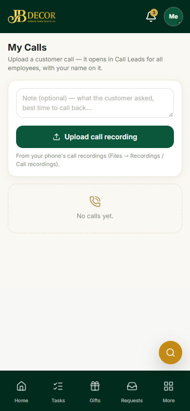
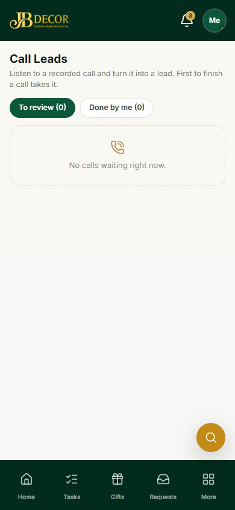
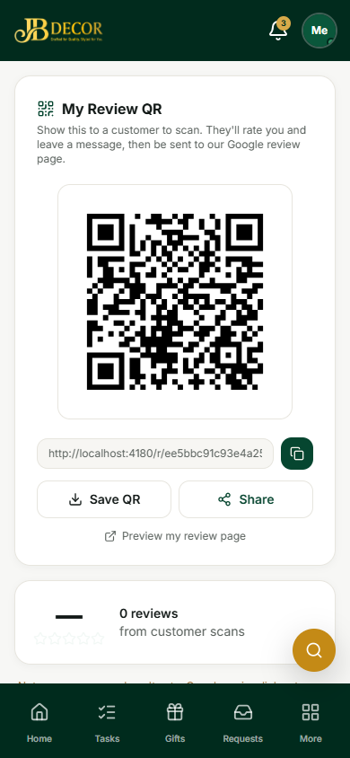

# Employee Guide — Calls, Call Leads & Review QR

**URLs:** `/employee/calls`, `/employee/call-leads`, `/employee/review-qr`

*Figure: My Calls*

*Figure: Call Leads*

*Figure: My Review QR*

## 1. Screens
- **My Calls** – upload a customer call recording you made (add an optional note such as "call back evening").
- **Call Leads** – tabs **To review** and **Done**. Listen to a recorded call, then turn it into a lead.
- **My Review QR** – your personal QR code, link, **Save QR** and **Share**, and the count of reviews customers gave you.

## 2. Step-by-step tasks
### Turn a call into a lead
1. More → **Call Leads → To review**.
2. Play the recording, then fill the quick lead form (name, phone, need) and submit. Or mark it **Not a lead**, or attach it to an existing lead.
3. The recording is saved on the lead's documents under *Voice notes*.

### Upload a call
My Calls → add a note → **Upload call recording** → choose the file from the phone's recordings folder. It opens in Call Leads for all employees; the first to finish it owns it.

### Collect customer reviews
1. More → **My Review QR**.
2. Show the QR to the customer or tap **Share** to send the link.
3. The customer rates you, writes a message, and is sent to the company's Google review page.
4. Customer reviews can add a **reward** to your payslip (set by admin).

## 3. Rules
- Call tasks close only with an outcome.
- Phone number, time and direction are read from the recording's file name; if missing, the file date is used.
- Unusual formats (.amr, .3gp, .wav) are converted automatically so they play on any phone.

## 4. Common questions
**Q: The recording will not play.** Wait a few seconds for conversion, or upload again as .m4a/.mp3.
**Q: Does the customer need to log in to review me?** No. The QR opens a public page.
