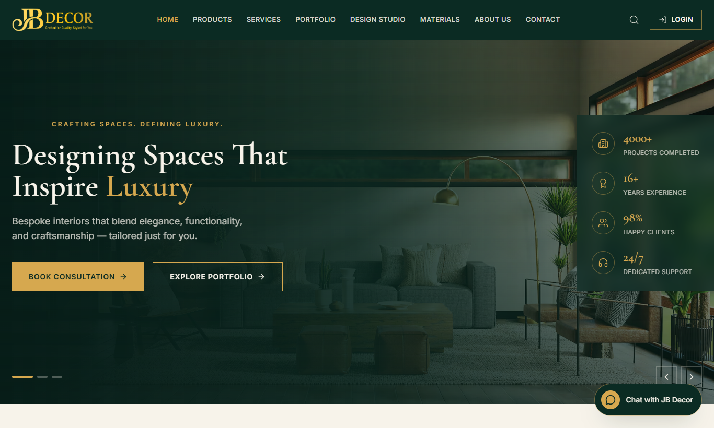
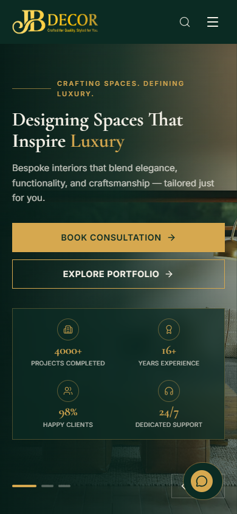
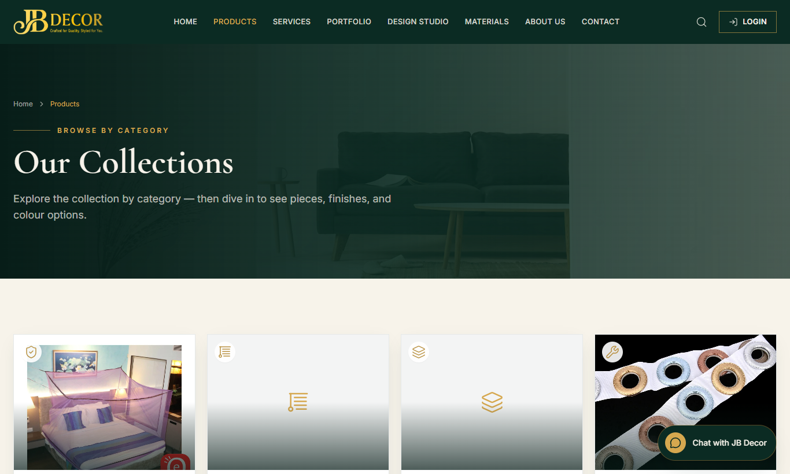
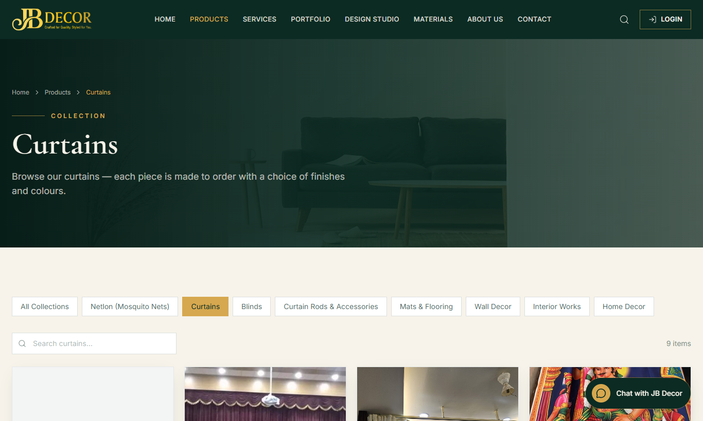
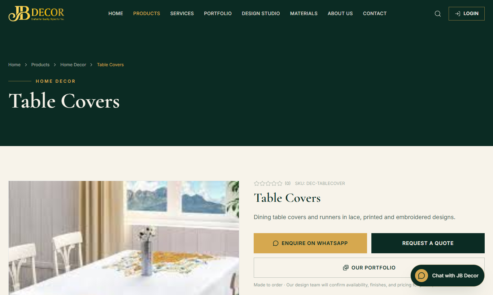
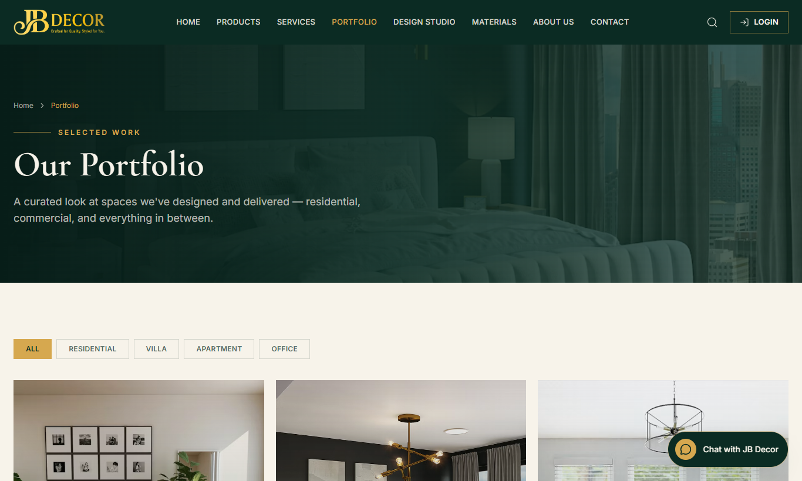
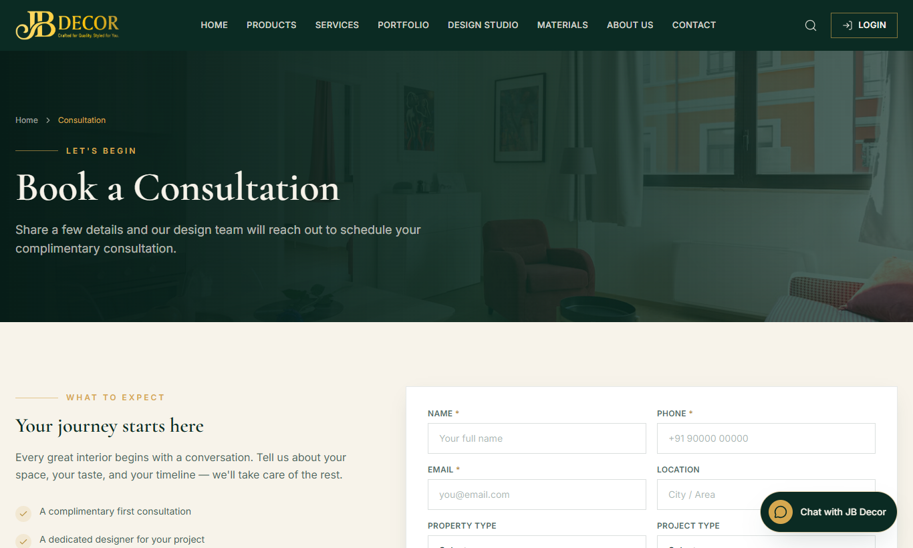
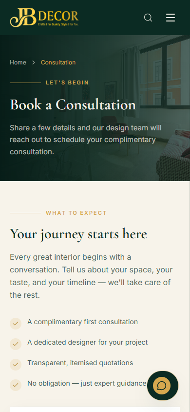

# Website Guide — Browsing the Site & Sending an Enquiry

**Audience:** website visitors and customers · **Site:** JB Decor public website (`/`)
**Related:** 02-tracking-quote-review, admin/14-website-cms, admin/02-leads

## 1. What the website is
The website is a **catalogue and enquiry** site, not an online shop. You browse curtains, blinds, mosquito nets, wallpapers and more, then ask for a quote or a free consultation. There is no cart or online payment. The team replies by phone or WhatsApp.

*Figure: Home page*

*Figure: Home page on a phone*

## 2. Menu and pages
Top menu: **Home · Products · Services · Portfolio · Design Studio · Materials · About Us · Contact**, a **Login** button (for the JB Decor team) and a **Chat with JB Decor** WhatsApp button at the bottom right.

| Page | What you can do |
|---|---|
| **Products** (`/products`) | See product categories (Netlon/Mosquito Nets, Curtains, Blinds, Curtain Rods & Accessories, Mats & Flooring, Wall Decor, Interior Works, Home Decor). Open a category to see its products. |
| **Product detail** | Photos, colours, description. Buttons: **Enquire on WhatsApp**, **Request a Quote**, **Our Portfolio**. |
| **Services** | What the company does (for example measurement service, tailoring and stitching). Open one for benefits and details. |
| **Portfolio** | Completed projects, filter by Residential, Villa, Apartment, Office. Open one for the story, location and photos. |
| **Materials** | Finishes such as wood, marble, granite, with filters by type. |
| **Design Studio** | Choose a room, a style and a colour palette to visualise a look. |
| **About / Contact** | Company story, address, phone, email, business hours. |
| **Privacy, Terms, Refund** | Legal pages (links at the bottom). |

*Figure: Products — browse by category*

*Figure: A category page (Curtains) with search*

*Figure: Product detail with Enquire and Request a Quote*

*Figure: Portfolio*

## 3. Step-by-step: how to ask for a quote
1. Open **Products**, choose a category, then a product.
2. Tap **Request a Quote** (or **Enquire on WhatsApp** to chat straight away).
3. Fill your name, phone and a short message; optionally your city and budget. Submit.
4. The team receives your enquiry, creates a lead and contacts you. You can then be sent a quote link (see guide 02).

## 4. Step-by-step: book a free consultation
1. Open **Consultation** (button on the home page or menu).
2. Fill **Name, Phone, Email, Location, Property type, Project type, Budget range** and a message.
3. Submit. Someone calls to fix a time. A site visit and measurement are arranged next.

*Figure: Book a Consultation*

*Figure: Consultation form on a phone*

## 5. What happens after you submit
Your enquiry appears in the company's Enquiries inbox and a task is created. The team converts it into a lead and a salesperson calls you. You are never charged for an enquiry.

## 6. Common questions
**Q: Can I buy online?** No. Choose products, then request a quote; payment is arranged with the team.
**Q: How do I contact the company quickly?** Use the green **Chat with JB Decor** WhatsApp button or the Contact page.
**Q: Why do some product pictures not load?** The image may be missing; the product details are still correct. Tell the team via Contact.
**Q: Is my data safe?** See the Privacy page. Details you enter are used only to answer your enquiry.
