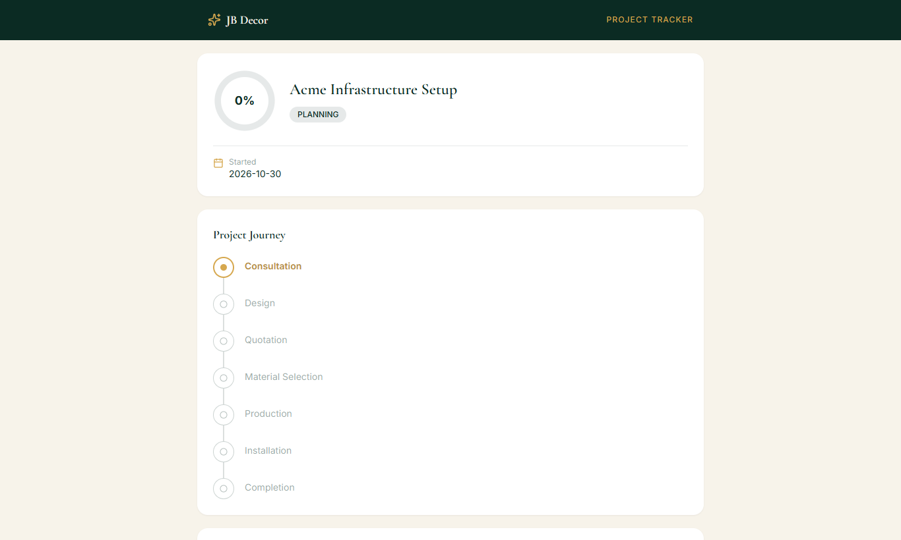
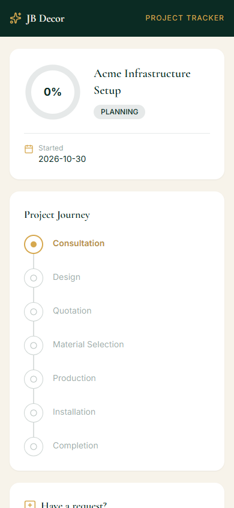
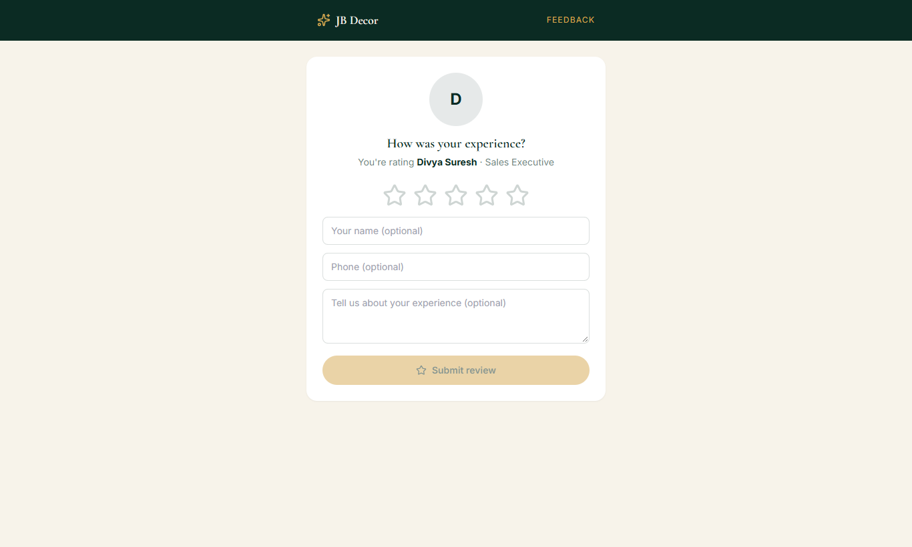

# Website Guide — Project Tracking, Viewing a Quote & Leaving a Review

**Audience:** customers · These pages need **no login**; the team sends you a private link.
**Related:** 01-browsing-and-enquiry, admin/05-projects, admin/04-site-visit-measurement-quote

## 1. Project tracking link (`/track/…`)
When your project starts, the team can send you a private tracking link by WhatsApp or SMS. Opening it shows:
- The project name, **percentage complete** and status.
- The **project journey** (for example Consultation → Design → Quotation → Material Selection → Production → Installation → Completion) with the current step highlighted.
- A way to send a request or leave a review (when enabled by the team).

*Figure: Project tracker*

*Figure: Project tracker on a phone*

**Tips**
- Keep the link private; anyone with it can see your project's progress.
- If the link stops working, ask the team to send a new one (they can regenerate it).
- The tracker shows progress only; payments and invoices are shared separately by the team.

## 2. Viewing your quote (`/q/…`)
The team can share your quotation as a private link. Open it to see:
- Items grouped by category with photos, colours, quantity, rate, discount and amount.
- Labour and shipping charges, GST and the **grand total**.
- Terms and conditions.
Ask the team to confirm the quote when you agree. Approval starts the project and, if you pay an advance, they record it.

## 3. Reviewing a team member (`/r/…`)
Each employee has a personal QR code. If someone served you well:
1. Scan their QR code (or open the link they send).
2. Tap the **stars** to rate, optionally add your name, phone and a message.
3. Tap **Submit review**. You are then taken to the company's **Google review** page, where you can post a public review too.

*Figure: "How was your experience?" review page*

Your rating is recorded against that employee. The company may hide inappropriate comments.

## 4. Common questions
**Q: I lost my tracking link.** Contact the team on WhatsApp or the Contact page.
**Q: The percentage did not change today.** Progress updates as work is recorded on site; it may lag a day.
**Q: Do I need an account?** No.
