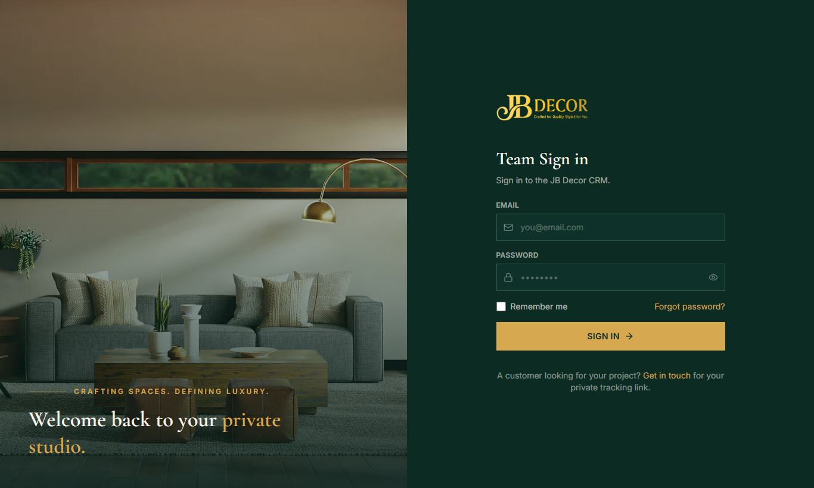
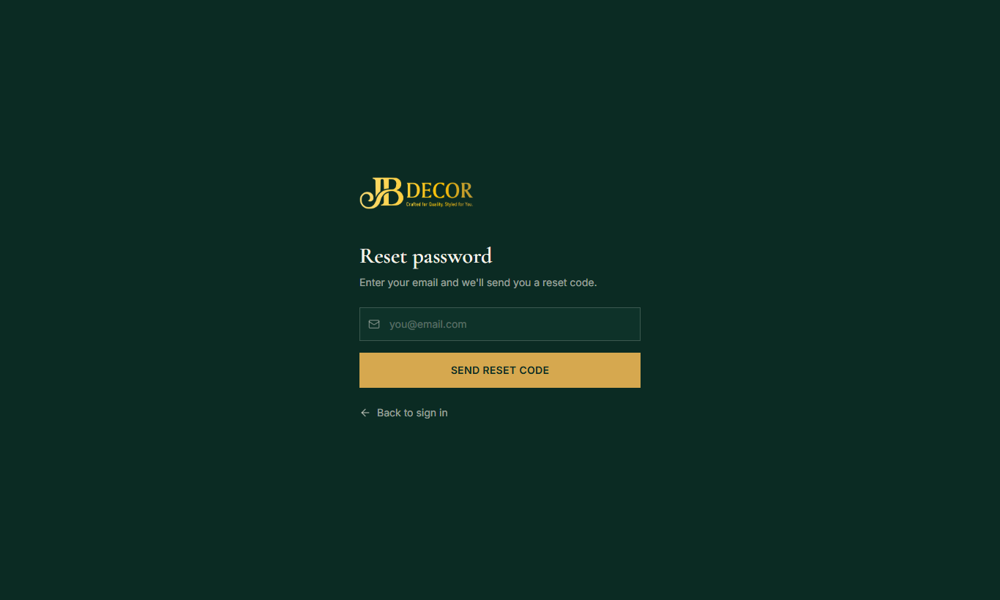

# Website Guide — Team Sign-in & Password Reset

**Audience:** JB Decor team members (admins and employees). Customers do not have accounts.
**URLs:** `/login`, `/forgot-password` · **Related:** admin/15-users-and-settings

## 1. One sign-in for everything
The **Login** button on the website opens the **Team Sign in** page. It is the only sign-in for the whole platform: admins are taken to the CRM desktop app, and employees to the mobile employee portal.

*Figure: Team Sign in*

The page says "A customer looking for your project? Get in touch or follow your project tracking link." The old customer self-service portal and self sign-up are switched off. Customers use the tracking and quote links instead (guide 02).

## 2. Step-by-step: sign in
1. Open the website and click **Login**.
2. Enter your **email** (or phone, if admin enabled phone sign-in) and password.
3. Tick **Remember me** on your own device, then **Sign in**.
4. If you use a temporary password you must set a new one immediately.

## 3. Step-by-step: forgot password
1. On the sign-in page click **Forgot password**.
2. Enter your email and press **Send reset code**.
3. A **6-digit code** arrives by email (valid 10 minutes). Enter it and choose a new password.
4. Sign in with the new password.

*Figure: Reset password*

## 4. Rules
- Wrong passwords repeatedly lock the account; an admin can unlock it.
- If the sign-in says you are not allowed (403), your account email is not verified or is disabled; contact an admin.
- Password rules: strong password required, not your email, not the same as the current one.

## 5. Common questions
**Q: I did not receive the code.** Check spam. If email is not configured on the server, ask an admin to reset your password.
**Q: Can customers log in?** No, not at present.
